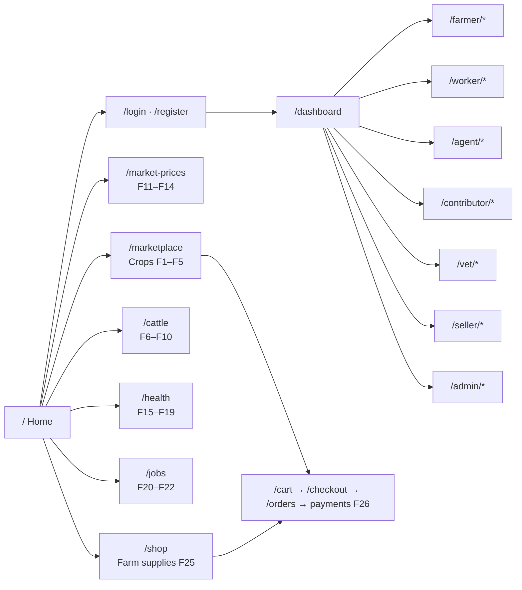

# Information architecture (IA) and route map

> **Living document.** This is the agreed structure of Krishi Bondhu: who uses it, how it is organised, and every
> URL. Teammates can add or change routes. Do it in the same PR as the code, following §6. Feature IDs refer to
> [docs/srs.md](srs.md). Visual rules are in [docs/design-system.md](design-system.md).

## 1. Principles

1. **One account, many roles.** A person can be a farmer, buyer, worker and more at once (SRS §2.3). URLs are organised by
   *task*, and role-only workspaces use a role prefix (`/farmer`, `/seller`, `/vet`, `/agent`, `/contributor`, `/worker`, `/admin`).
2. **Browse first, sign in to act.** Marketplace, prices, supplies, vets and jobs are public to read. Buying, posting,
   recording and requesting need an account.
3. **Every page has a route name, and code uses names, not paths.** Always write `route('marketplace.index')`, never `'/marketplace'`.
4. **RESTful and predictable.** Standard Laravel resource actions (`index, create, store, show, edit, update, destroy`),
   plural nouns, kebab-case URIs, no verbs in URIs except clear state changes (`/orders/{order}/cancel`).
5. **Bangla and English share one URL.** Language is a user preference (F24), not a URL prefix.
6. **One web app.** JSON endpoints (e.g. voice) are ordinary web routes for our own pages. There is no separate API backend.

## 2. Users and roles

| Role | Main areas | Workspace prefix |
| --- | --- | --- |
| Visitor (not signed in) | Browse marketplace, prices, supplies, vets, jobs; register | none |
| Buyer | Search, bulk requests, negotiate, cart, checkout, orders, payments | none (any signed-in user can buy) |
| Farmer | Crop listings and orders, cattle, guidance, treatments, jobs | `/farmer`, `/cattle`, `/guidance` |
| Agricultural worker | Find jobs, apply, bookings, groups | `/worker` |
| Insemination agent | Records for cattle shared with them | `/agent` |
| Market price contributor | Enter and update prices | `/contributor` |
| Veterinarian | Profile, visit requests | `/vet` |
| Agricultural product seller | Products and orders | `/seller` |
| Administrator | Users, listings, markets, complaints, activity | `/admin` |

## 3. Navigation

**Primary navigation (header):** Marketplace · Market prices · Farm supplies · Cattle · Health · Farm jobs.
**Header actions:** language (EN / বাং), theme, cart, notifications (signed in), Log in / Join or Dashboard.
**Footer:** Buy and sell · Farm care · Project links.
**Dashboard (`/dashboard`):** role-aware home after sign-in. It shows a card per role the user holds, linking into that role's workspace.



### Key journeys

| Journey | Path |
| --- | --- |
| Farmer sells a crop | `farmer.listings.create` → `farmer.listings.store` → `marketplace.show` → `farmer.orders.index` |
| Buyer buys a small amount | `marketplace.index` → `marketplace.show` → `cart.items.store` → `cart.show` → `checkout.show` → `checkout.store` → `payments.store` → `orders.show` |
| Buyer buys in bulk | `bulk-requests.create` → farmers `bulk-requests.bids.store` → `bulk-requests.bids.accept`, or `marketplace.offers.store` → `negotiations.show` (counter/accept) → order |
| Farmer records breeding | `cattle.show` → `breeding-check.create` → `cattle.inseminations.create` → `cattle.pregnancies.create` → `pregnancies.calving` |
| Farmer gets help for a sick cow | `guidance.animal-health.create` → result → `vets.index` → `vets.visit-requests.store` → `visit-requests.show` |
| Farmer hires workers | `farmer.jobs.create` → workers `jobs.applications.store` → `farmer.jobs.applications.update` → `farmer.jobs.bookings.store` → `bookings.show` |

## 4. Conventions

| Topic | Rule |
| --- | --- |
| Route files | `routes/web.php` includes one file per area from `routes/modules/`. Add routes to your area's file. |
| Names | `area.resource.action`, e.g. `farmer.listings.create`. Resource routes get names automatically. |
| URIs | kebab-case plurals: `/bulk-requests`, `/market-prices/compare`. Nested only one level (`/cattle/{cattle}/inseminations`, shallow for record pages). |
| Parameters | Named after the model in camelCase: `{listing}`, `{bulkRequest}`, `{visitRequest}`. Use route-model binding. |
| Static before dynamic | Put fixed segments above parameters (`/markets/map` before `/markets/{market}`). |
| Controllers | One resource controller per model/workflow in `app/Http/Controllers` (sub-folders allowed, e.g. `Farmer/`). Keep business rules in models or `app/Services` (SRS §2.5), not in controllers or views. |
| Forms | Validate with Form Requests (`php artisan make:request`). Use the shared Blade components. |
| Access | Add `auth` / role middleware or policies when authentication exists. The intended rule for each route is in §5. |
| Status codes | Planned routes: GET shows a "planned page" (200); other methods return 501 until built. |

## 5. Route map

All routes below are **registered now**. Until built, they point at `App\Http\Controllers\PlannedController`.
The tables are generated from `php artisan route:list`. If you change routes, update the matching table in the same PR.

### 5.1 Platform

File: `routes/web.php` · 2 routes

| Method | URI | Route name | Feature | Access (when auth is built) |
| --- | --- | --- | --- | --- |
| `GET` | `/` | `home` | — | Public |
| `GET` | `/design-system` | `design-system` | — | Public |

### 5.2 Accounts

File: `routes/modules/account.php` · 25 routes

| Method | URI | Route name | Feature | Access (when auth is built) |
| --- | --- | --- | --- | --- |
| `GET` | `/account/preferences` | `preferences.edit` | F24 | Auth |
| `PATCH` | `/account/preferences` | `preferences.update` | F24 | Auth |
| `GET` | `/account/profile` | `profile.edit` | Supporting | Auth |
| `PATCH` | `/account/profile` | `profile.update` | Supporting | Auth |
| `GET` | `/account/roles` | `roles.index` | Supporting | Auth |
| `POST` | `/account/roles` | `roles.store` | Supporting | Auth |
| `DELETE` | `/account/roles/{role}` | `roles.destroy` | Supporting | Auth |
| `GET` | `/dashboard` | `dashboard` | Supporting | Auth |
| `GET` | `/forgot-password` | `password.request` | Supporting (not a feature) | Guest |
| `POST` | `/forgot-password` | `password.email` | Supporting (not a feature) | Guest |
| `GET` | `/login` | `login` | Supporting (not a feature) | Guest |
| `POST` | `/login` | `login.store` | Supporting (not a feature) | Guest |
| `POST` | `/logout` | `logout` | Supporting | Auth |
| `GET` | `/notifications` | `notifications.index` | Supporting (F5, F10, F19 status updates) | Auth |
| `POST` | `/notifications/read-all` | `notifications.read-all` | Supporting (F5, F10, F19 status updates) | Auth |
| `PATCH` | `/notifications/{notification}/read` | `notifications.read` | Supporting (F5, F10, F19 status updates) | Auth |
| `POST` | `/preferences/locale` | `preferences.locale` | F24 | Public |
| `GET` | `/register` | `register` | Supporting (not a feature) | Guest |
| `POST` | `/register` | `register.store` | Supporting (not a feature) | Guest |
| `GET` | `/reminders` | `reminders.index` | F10, F19 | Auth |
| `PATCH` | `/reminders/{reminder}/done` | `reminders.complete` | F10, F19 | Auth |
| `POST` | `/reset-password` | `password.update` | Supporting (not a feature) | Guest |
| `GET` | `/reset-password/{token}` | `password.reset` | Supporting (not a feature) | Guest |
| `POST` | `/voice/speak` | `voice.speak` | F23 | Auth |
| `POST` | `/voice/transcribe` | `voice.transcribe` | F23 | Auth |

### 5.3 Marketplace

File: `routes/modules/marketplace.php` · 41 routes

| Method | URI | Route name | Feature | Access (when auth is built) |
| --- | --- | --- | --- | --- |
| `GET` | `/bulk-requests` | `bulk-requests.index` | F2 | Auth |
| `POST` | `/bulk-requests` | `bulk-requests.store` | F2 | Buyer |
| `GET` | `/bulk-requests/create` | `bulk-requests.create` | F2 | Buyer |
| `GET` | `/bulk-requests/{bulkRequest}` | `bulk-requests.show` | F2 | Auth |
| `POST` | `/bulk-requests/{bulkRequest}/bids` | `bulk-requests.bids.store` | F2 | Farmer |
| `POST` | `/bulk-requests/{bulkRequest}/bids/{bid}/accept` | `bulk-requests.bids.accept` | F2 | Buyer |
| `PATCH` | `/bulk-requests/{bulkRequest}/close` | `bulk-requests.close` | F2 | Buyer |
| `GET` | `/cart` | `cart.show` | F5, F25 | Auth |
| `POST` | `/cart/items` | `cart.items.store` | F5, F25 | Auth |
| `PATCH` | `/cart/items/{item}` | `cart.items.update` | F5, F25 | Auth |
| `DELETE` | `/cart/items/{item}` | `cart.items.destroy` | F5, F25 | Auth |
| `GET` | `/checkout` | `checkout.show` | F4 | Auth |
| `GET` | `/crop-listing-photos/{photo}/{variant}` | `crop-listing-photos.show` | F1 | Public while the listing is published; its owner while hidden; nobody once removed (`variant`: `thumb` or `display`) |
| `POST` | `/checkout` | `checkout.store` | F4 | Auth |
| `GET` | `/farmer/listings` | `farmer.listings.index` | F1 | Farmer (one listing: its owner; other farmers get 404) |
| `POST` | `/farmer/listings` | `farmer.listings.store` | F1 | Farmer (one listing: its owner; other farmers get 404) |
| `GET` | `/farmer/listings/create` | `farmer.listings.create` | F1 | Farmer (one listing: its owner; other farmers get 404) |
| `GET` | `/farmer/listings/{listing}` | `farmer.listings.show` | F1 | Farmer (one listing: its owner; other farmers get 404) |
| `PUT|PATCH` | `/farmer/listings/{listing}` | `farmer.listings.update` | F1 | Farmer (one listing: its owner; other farmers get 404) |
| `DELETE` | `/farmer/listings/{listing}` | `farmer.listings.destroy` | F1 | Farmer (one listing: its owner; other farmers get 404) |
| `GET` | `/farmer/listings/{listing}/edit` | `farmer.listings.edit` | F1 | Farmer (one listing: its owner; other farmers get 404) |
| `GET` | `/farmer/orders` | `farmer.orders.index` | F5 | Farmer |
| `GET` | `/farmer/orders/{order}` | `farmer.orders.show` | F5 | Farmer |
| `PATCH` | `/farmer/orders/{order}/status` | `farmer.orders.status` | F5 | Farmer |
| `GET` | `/marketplace` | `marketplace.index` | F2, F1 | Public (published listings only) |
| `GET` | `/marketplace/crops/{listing}` | `marketplace.show` | F2, F1 | Public (published listings only, otherwise 404) |
| `POST` | `/marketplace/crops/{listing}/offers` | `marketplace.offers.store` | F3 | Auth (buyer or seller in the negotiation) |
| `GET` | `/negotiations` | `negotiations.index` | F3 | Auth (buyer or seller in the negotiation) |
| `GET` | `/negotiations/{negotiation}` | `negotiations.show` | F3 | Auth (buyer or seller in the negotiation) |
| `POST` | `/negotiations/{negotiation}/accept` | `negotiations.accept` | F3 | Auth (buyer or seller in the negotiation) |
| `POST` | `/negotiations/{negotiation}/counter` | `negotiations.counter` | F3 | Auth (buyer or seller in the negotiation) |
| `POST` | `/negotiations/{negotiation}/reject` | `negotiations.reject` | F3 | Auth (buyer or seller in the negotiation) |
| `GET` | `/orders` | `orders.index` | F5 | Auth (order owner) |
| `GET` | `/orders/{order}` | `orders.show` | F5 | Auth (order owner) |
| `POST` | `/orders/{order}/cancel` | `orders.cancel` | F5 | Auth (order owner) |
| `POST` | `/orders/{order}/payments` | `payments.store` | F26 | Auth (order owner) |
| `POST` | `/payments/callback/cancel` | `payments.callback.cancel` | F26 | Payment provider (CSRF-exempt, verified) |
| `POST` | `/payments/callback/fail` | `payments.callback.fail` | F26 | Payment provider (CSRF-exempt, verified) |
| `POST` | `/payments/callback/success` | `payments.callback.success` | F26 | Payment provider (CSRF-exempt, verified) |
| `POST` | `/payments/ipn` | `payments.ipn` | F26 | Payment provider (CSRF-exempt, verified) |
| `GET` | `/payments/{payment}` | `payments.show` | F26 | Auth (order owner) |

### 5.4 Cattle

File: `routes/modules/cattle.php` · 33 routes

| Method | URI | Route name | Feature | Access (when auth is built) |
| --- | --- | --- | --- | --- |
| `GET` | `/agent/cattle` | `agent.cattle.index` | F7 | Insemination agent |
| `GET` | `/agent/inseminations` | `agent.inseminations.index` | F7 | Insemination agent |
| `GET` | `/breeding-check` | `breeding-check.create` | F9 | Farmer or insemination agent |
| `POST` | `/breeding-check` | `breeding-check.store` | F9 | Farmer or insemination agent |
| `GET` | `/cattle` | `cattle.index` | F6 | Farmer (own cattle; another farmer gets 404) |
| `POST` | `/cattle` | `cattle.store` | F6 | Farmer (own cattle; another farmer gets 404) |
| `GET` | `/cattle/create` | `cattle.create` | F6 | Farmer (own cattle; another farmer gets 404) |
| `GET` | `/cattle/{cattle}` | `cattle.show` | F6 | Farmer (own cattle; another farmer gets 404) |
| `PUT|PATCH` | `/cattle/{cattle}` | `cattle.update` | F6 | Farmer (own cattle; another farmer gets 404) |
| `DELETE` | `/cattle/{cattle}` | `cattle.destroy` | F6 | Farmer (own cattle; another farmer gets 404) |
| `POST` | `/cattle/{cattle}/agents` | `cattle.agents.store` | F7 | Farmer (own cattle) |
| `DELETE` | `/cattle/{cattle}/agents/{agent}` | `cattle.agents.destroy` | F7 | Farmer (own cattle) |
| `GET` | `/cattle/{cattle}/edit` | `cattle.edit` | F6 | Farmer (own cattle; another farmer gets 404) |
| `GET` | `/cattle/{cattle}/health-history/create` | `cattle.health-history.create` | F6 | Farmer (own, active cattle) |
| `POST` | `/cattle/{cattle}/health-history` | `cattle.health-history.store` | F6 | Farmer (own, active cattle) |
| `GET` | `/cattle/{cattle}/health-history/{entry}/edit` | `cattle.health-history.edit` | F6 | Farmer (own, active cattle; the entry must belong to this animal) |
| `PUT|PATCH` | `/cattle/{cattle}/health-history/{entry}` | `cattle.health-history.update` | F6 | Farmer (own, active cattle; the entry must belong to this animal) |
| `GET` | `/cattle/{cattle}/photo/{variant}` | `cattle.photo` | F6 | Farmer (own cattle only; `variant`: `thumb` or `display`) |
| `GET` | `/cattle/{cattle}/family-tree` | `cattle.family-tree` | F8 | Farmer (own cattle) |
| `GET` | `/cattle/{cattle}/inseminations` | `cattle.inseminations.index` | F7 | Insemination agent (shared cattle); farmer can view |
| `POST` | `/cattle/{cattle}/inseminations` | `cattle.inseminations.store` | F7 | Insemination agent (shared cattle); farmer can view |
| `GET` | `/cattle/{cattle}/inseminations/create` | `cattle.inseminations.create` | F7 | Insemination agent (shared cattle); farmer can view |
| `PUT` | `/cattle/{cattle}/parents` | `cattle.parents.update` | F8 | Farmer (own cattle) |
| `GET` | `/cattle/{cattle}/pregnancies` | `cattle.pregnancies.index` | F10 | Farmer (own cattle) |
| `POST` | `/cattle/{cattle}/pregnancies` | `cattle.pregnancies.store` | F10 | Farmer (own cattle) |
| `GET` | `/cattle/{cattle}/pregnancies/create` | `cattle.pregnancies.create` | F10 | Farmer (own cattle) |
| `GET` | `/inseminations/{insemination}` | `inseminations.show` | F7 | Insemination agent (shared cattle); farmer can view |
| `PUT|PATCH` | `/inseminations/{insemination}` | `inseminations.update` | F7 | Insemination agent (shared cattle); farmer can view |
| `GET` | `/inseminations/{insemination}/edit` | `inseminations.edit` | F7 | Insemination agent (shared cattle); farmer can view |
| `GET` | `/pregnancies/{pregnancy}` | `pregnancies.show` | F10 | Farmer (own cattle) |
| `PUT|PATCH` | `/pregnancies/{pregnancy}` | `pregnancies.update` | F10 | Farmer (own cattle) |
| `POST` | `/pregnancies/{pregnancy}/calving` | `pregnancies.calving` | F10 | Farmer (own cattle) |
| `GET` | `/pregnancies/{pregnancy}/edit` | `pregnancies.edit` | F10 | Farmer (own cattle) |

### 5.5 Market prices

File: `routes/modules/market-prices.php` · 11 routes

| Method | URI | Route name | Feature | Access (when auth is built) |
| --- | --- | --- | --- | --- |
| `GET` | `/contributor/prices` | `contributor.prices.index` | F11 | Market price contributor |
| `POST` | `/contributor/prices` | `contributor.prices.store` | F11 | Market price contributor |
| `GET` | `/contributor/prices/create` | `contributor.prices.create` | F11 | Market price contributor |
| `PUT|PATCH` | `/contributor/prices/{price}` | `contributor.prices.update` | F11 | Market price contributor |
| `GET` | `/contributor/prices/{price}/edit` | `contributor.prices.edit` | F11 | Market price contributor |
| `GET` | `/market-prices` | `market-prices.index` | F11 | Public |
| `GET` | `/market-prices/compare` | `market-prices.compare` | F13 | Public |
| `GET` | `/market-prices/trends` | `market-prices.trends` | F14 | Public |
| `GET` | `/markets` | `markets.index` | F12 | Public |
| `GET` | `/markets/map` | `markets.map` | F12 | Public |
| `GET` | `/markets/{market}` | `markets.show` | F12 | Public |

### 5.6 Health

File: `routes/modules/health.php` · 29 routes

| Method | URI | Route name | Feature | Access (when auth is built) |
| --- | --- | --- | --- | --- |
| `GET` | `/guidance/animal-health` | `guidance.animal-health.index` | F17 | Farmer |
| `POST` | `/guidance/animal-health` | `guidance.animal-health.store` | F17 | Farmer |
| `GET` | `/guidance/animal-health/create` | `guidance.animal-health.create` | F17 | Farmer |
| `GET` | `/guidance/animal-health/{record}` | `guidance.animal-health.show` | F17 | Farmer |
| `GET` | `/guidance/crop-health` | `guidance.crop-health.index` | F16 | Farmer |
| `POST` | `/guidance/crop-health` | `guidance.crop-health.store` | F16 | Farmer |
| `GET` | `/guidance/crop-health/create` | `guidance.crop-health.create` | F16 | Farmer |
| `GET` | `/guidance/crop-health/{record}` | `guidance.crop-health.show` | F16 | Farmer |
| `GET` | `/guidance/soil` | `guidance.soil.index` | F15 | Farmer |
| `POST` | `/guidance/soil` | `guidance.soil.store` | F15 | Farmer |
| `GET` | `/guidance/soil/create` | `guidance.soil.create` | F15 | Farmer |
| `GET` | `/guidance/soil/{record}` | `guidance.soil.show` | F15 | Farmer |
| `GET` | `/health` | `health.index` | F15–F19 hub | Public |
| `GET` | `/treatments` | `treatments.index` | F19 | Farmer |
| `POST` | `/treatments` | `treatments.store` | F19 | Farmer |
| `GET` | `/treatments/create` | `treatments.create` | F19 | Farmer |
| `GET` | `/treatments/{treatment}` | `treatments.show` | F19 | Farmer |
| `PUT|PATCH` | `/treatments/{treatment}` | `treatments.update` | F19 | Farmer |
| `DELETE` | `/treatments/{treatment}` | `treatments.destroy` | F19 | Farmer |
| `GET` | `/treatments/{treatment}/edit` | `treatments.edit` | F19 | Farmer |
| `GET` | `/vet/profile` | `vet.profile.edit` | F18 | Veterinarian |
| `PATCH` | `/vet/profile` | `vet.profile.update` | F18 | Veterinarian |
| `GET` | `/vet/visit-requests` | `vet.visit-requests.index` | F18 | Veterinarian |
| `PATCH` | `/vet/visit-requests/{visitRequest}` | `vet.visit-requests.update` | F18 | Veterinarian |
| `GET` | `/vets` | `vets.index` | F18 | Public |
| `GET` | `/vets/{vet}` | `vets.show` | F18 | Public |
| `POST` | `/vets/{vet}/visit-requests` | `vets.visit-requests.store` | F18 | Farmer |
| `GET` | `/visit-requests` | `visit-requests.index` | F18 | Farmer |
| `GET` | `/visit-requests/{visitRequest}` | `visit-requests.show` | F18 | Farmer |

### 5.7 Jobs

File: `routes/modules/jobs.php` · 29 routes

| Method | URI | Route name | Feature | Access (when auth is built) |
| --- | --- | --- | --- | --- |
| `GET` | `/bookings` | `bookings.index` | F21 | Auth (farmer or worker in the booking) |
| `GET` | `/bookings/{booking}` | `bookings.show` | F21 | Auth (farmer or worker in the booking) |
| `POST` | `/bookings/{booking}/cancel` | `bookings.cancel` | F21 | Auth (farmer or worker in the booking) |
| `GET` | `/complaints` | `complaints.index` | F22 | Farmer or agricultural worker |
| `POST` | `/complaints` | `complaints.store` | F22 | Farmer or agricultural worker |
| `GET` | `/complaints/create` | `complaints.create` | F22 | Farmer or agricultural worker |
| `GET` | `/complaints/{complaint}` | `complaints.show` | F22 | Farmer or agricultural worker |
| `GET` | `/farmer/jobs` | `farmer.jobs.index` | F20 | Farmer |
| `POST` | `/farmer/jobs` | `farmer.jobs.store` | F20 | Farmer |
| `GET` | `/farmer/jobs/create` | `farmer.jobs.create` | F20 | Farmer |
| `GET` | `/farmer/jobs/{job}` | `farmer.jobs.show` | F20 | Auth (open job, or job owner) |
| `PUT|PATCH` | `/farmer/jobs/{job}` | `farmer.jobs.update` | F20 | Farmer (job owner) |
| `GET` | `/farmer/jobs/{job}/applications` | `farmer.jobs.applications.index` | F21 | Farmer (job owner) |
| `PATCH` | `/farmer/jobs/{job}/applications/{application}` | `farmer.jobs.applications.update` | F21 | Farmer (job owner) |
| `POST` | `/farmer/jobs/{job}/bookings` | `farmer.jobs.bookings.store` | F21 | Farmer (job owner) |
| `PATCH` | `/farmer/jobs/{job}/close` | `farmer.jobs.close` | F20 | Farmer (job owner) |
| `GET` | `/farmer/jobs/{job}/edit` | `farmer.jobs.edit` | F20 | Farmer (job owner) |
| `GET` | `/jobs` | `jobs.index` | F20 | Public |
| `GET` | `/jobs/{job}` | `jobs.show` | F20 | Public (open job dated today or later); job owner for closed and past jobs |
| `POST` | `/jobs/{job}/applications` | `jobs.applications.store` | F21 | Agricultural worker |
| `GET` | `/worker/applications` | `worker.applications.index` | F21 | Agricultural worker |
| `PATCH` | `/worker/applications/{application}` | `worker.applications.update` | F21 | Agricultural worker |
| `GET` | `/worker/groups` | `worker.groups.index` | F21 | Agricultural worker |
| `POST` | `/worker/groups` | `worker.groups.store` | F21 | Agricultural worker |
| `GET` | `/worker/groups/create` | `worker.groups.create` | F21 | Agricultural worker |
| `GET` | `/worker/groups/{group}` | `worker.groups.show` | F21 | Agricultural worker |
| `PUT|PATCH` | `/worker/groups/{group}` | `worker.groups.update` | F21 | Agricultural worker |
| `DELETE` | `/worker/groups/{group}` | `worker.groups.destroy` | F21 | Agricultural worker |
| `GET` | `/worker/groups/{group}/edit` | `worker.groups.edit` | F21 | Agricultural worker |

### 5.8 Farm supplies

File: `routes/modules/shop.php` · 13 routes

| Method | URI | Route name | Feature | Access (when auth is built) |
| --- | --- | --- | --- | --- |
| `GET` | `/seller/orders` | `seller.orders.index` | F25 | Agricultural product seller |
| `GET` | `/seller/orders/{order}` | `seller.orders.show` | F25 | Agricultural product seller |
| `PATCH` | `/seller/orders/{order}/status` | `seller.orders.status` | F25 | Agricultural product seller |
| `GET` | `/seller/products` | `seller.products.index` | F25 | Agricultural product seller (one product: its owner; other sellers get 404) |
| `POST` | `/seller/products` | `seller.products.store` | F25 | Agricultural product seller (one product: its owner; other sellers get 404) |
| `GET` | `/seller/products/create` | `seller.products.create` | F25 | Agricultural product seller (one product: its owner; other sellers get 404) |
| `GET` | `/seller/products/{product}` | `seller.products.show` | F25 | Agricultural product seller (one product: its owner; other sellers get 404) |
| `PUT|PATCH` | `/seller/products/{product}` | `seller.products.update` | F25 | Agricultural product seller (one product: its owner; other sellers get 404) |
| `DELETE` | `/seller/products/{product}` | `seller.products.destroy` | F25 | Agricultural product seller (one product: its owner; other sellers get 404) |
| `GET` | `/seller/products/{product}/edit` | `seller.products.edit` | F25 | Agricultural product seller (one product: its owner; other sellers get 404) |
| `GET` | `/shop` | `shop.index` | F25 | Public |
| `GET` | `/shop/products/{product}` | `shop.show` | F25 | Public |
| `POST` | `/shop/products/{product}/offers` | `shop.offers.store` | F25, F3 | Auth |

### 5.9 Administration

File: `routes/modules/admin.php` · 16 routes

| Method | URI | Route name | Feature | Access (when auth is built) |
| --- | --- | --- | --- | --- |
| `GET` | `/admin` | `admin.dashboard` | Administration (SRS §2.2) | Administrator |
| `GET` | `/admin/activity` | `admin.activity` | Administration (SRS §2.2) | Administrator |
| `GET` | `/admin/complaints` | `admin.complaints.index` | F22 | Administrator |
| `GET` | `/admin/complaints/{complaint}` | `admin.complaints.show` | F22 | Administrator |
| `PATCH` | `/admin/complaints/{complaint}` | `admin.complaints.update` | F22 | Administrator |
| `GET` | `/admin/listings` | `admin.listings.index` | Administration (SRS §2.2) | Administrator |
| `PATCH` | `/admin/listings/{listing}` | `admin.listings.update` | Administration (SRS §2.2) | Administrator |
| `GET` | `/admin/markets` | `admin.markets.index` | Supports F11, F12 | Administrator |
| `POST` | `/admin/markets` | `admin.markets.store` | Supports F11, F12 | Administrator |
| `GET` | `/admin/markets/create` | `admin.markets.create` | Supports F11, F12 | Administrator |
| `PUT|PATCH` | `/admin/markets/{market}` | `admin.markets.update` | Supports F11, F12 | Administrator |
| `DELETE` | `/admin/markets/{market}` | `admin.markets.destroy` | Supports F11, F12 | Administrator |
| `GET` | `/admin/markets/{market}/edit` | `admin.markets.edit` | Supports F11, F12 | Administrator |
| `GET` | `/admin/users` | `admin.users.index` | Administration (SRS §2.2) | Administrator |
| `GET` | `/admin/users/{user}` | `admin.users.show` | Administration (SRS §2.2) | Administrator |
| `PATCH` | `/admin/users/{user}` | `admin.users.update` | Administration (SRS §2.2) | Administrator |

## 6. Building a planned route (how to change this map)

1. Find your route in §5 and its file in `routes/modules/`.
2. Create your controller (`php artisan make:controller Farmer/CropListingController --resource`), model, migration and views.
3. Swap the controller and **keep the URI and the route name**:

   ```php
   // before
   Route::resource('farmer/listings', PlannedController::class)->names('farmer.listings')->parameters(['listings' => 'listing']);
   // after
   Route::resource('farmer/listings', CropListingController::class)->names('farmer.listings')->parameters(['listings' => 'listing']);
   ```

   If only some actions are ready, split them: keep `->only([...])` on your controller and leave the rest on `PlannedController` for now.
4. Add the access rule from §5. Authentication exists: wrap signed-in routes in `Route::middleware('auth')`, and check
   roles with `$request->user()->hasRole(Role::FARMER)` (constants in `App\Models\Role`) or a policy.
   `RouteMapTest` expects parameter-free `auth` pages to redirect guests to `login`.
5. Need a new route? Add it to the right module file, give it a name following §4, add a row to §5, and mention it in your PR.
   Renaming or removing a route others use needs a quick team agreement, because their links depend on it.
6. Payment provider callbacks (`payments.callback.*`, `payments.ipn`) must be excluded from CSRF in `bootstrap/app.php`
   and must verify the provider's signature/validation API before marking anything paid.
7. Run `composer check`. The route tests fail if a route has no name or a parameter-free page does not render.

## 7. Open IA questions (decide as features are built)

- Home page content and dashboard cards per role (owners of the related features to propose).
- Whether saved form progress (F24) uses server drafts or browser storage. No route is reserved yet.
- Map provider integration details for `markets.map` and `vets.index` (Leaflet + OpenStreetMap per SRS).
- Whether admins also need direct edit access to cattle or price records (not in the SRS today).

## Change log

| Date | Change | By |
| --- | --- | --- |
| 2026-11-12 | Initial IA, navigation and full route map (193 routes) for F1–F26. | Emon (with Claude Code) |
| 2026-11-12 | `home` now renders a basic landing page (`resources/views/home.blade.php`) instead of PlannedController. | Emon (with Claude Code) |
| 2026-11-13 | Built `login`, `login.store`, `register`, `register.store`, `logout`, `dashboard` and `preferences.locale` (issue #7). Guest/auth middleware applied to the authentication and session groups in `routes/modules/account.php`; URIs and names unchanged. | Emon (with Claude Code) |
| 2026-11-13 | Built the F20 routes (`jobs.index`, `jobs.show`, `farmer.jobs.*`) with `FarmJobController`; URIs and names unchanged. **Removed `farmer.jobs.destroy`** and **added `farmer.jobs.close`** (`PATCH /farmer/jobs/{job}/close`): jobs are closed, not deleted, so F21 applications and bookings can keep referencing them. `/farmer/jobs/*` is behind `auth`; the Farmer role and ownership are checked by `FarmJobPolicy`. | Mehrab (with Claude Code) |
| 2026-11-13 | Built the F1 routes (`farmer.listings.*`, `marketplace.index`, `marketplace.show`) with `Farmer\CropListingController` and `MarketplaceController`; URIs and names unchanged. **Added `crop-listing-photos.show`** (`GET /crop-listing-photos/{photo}/{variant}`): listing photos are private files and this route checks the listing's visibility on every request. `/farmer/listings/*` is behind `auth`; the Farmer role and ownership are checked by `CropListingPolicy`; per account, 10 new listings and 30 changes per minute. After publishing, the farmer lands on `farmer.listings.show`, which links to the public page. Cart and offer buttons on `marketplace.show` post to the still-planned `cart.items.store` and `marketplace.offers.store`. | Emon (with Claude Code) |
| 2026-11-13 | Built the F6 routes (`cattle.index/create/store/show/edit/update/destroy`) with `CattleController`; URIs and names unchanged. `cattle.destroy` **archives** (sets `archived_at`) and `cattle.update` with `operation=restore` brings it back; nothing is deleted. **Added** `cattle.photo` (private photos, owner only) and `cattle.health-history.create/store/edit/update` (`CattleHealthEntryController`). All behind `auth`; the Farmer role and ownership are checked by `CattlePolicy`. Per account, 10 registrations and 30 other changes per minute. The F7–F10 and F18 routes are unchanged and still planned; the cattle profile links to them with a "Planned" label. | Emon (with Claude Code) |
