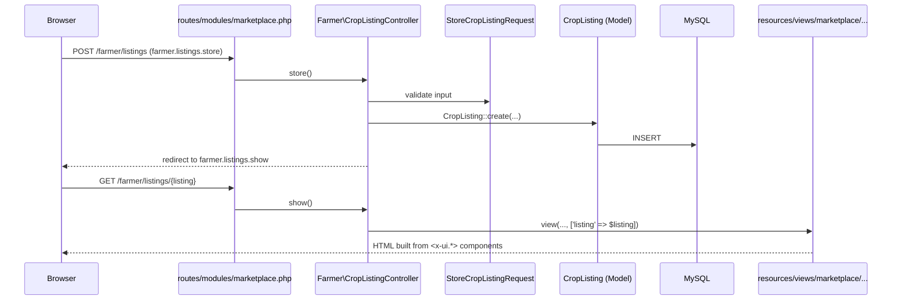

# Architecture: where frontend, backend and database live

Krishi Bondhu is **one Laravel application** following **MVC**, as the course requires (project outline §6).
We do **not** use separate top-level `frontend/`, `backend/` or `database/` folders. Laravel already separates them
by convention, and keeping that structure makes the Model, View and Controller layers obvious in the viva and in
faculty review. Moving them would break autoloading, artisan generators and every Laravel tutorial the team relies on.

## The map

| Concern | MVC layer | Folder | What goes there |
| --- | --- | --- | --- |
| **Frontend** | View | `resources/views/` | Blade pages, grouped by area: `marketplace/`, `cattle/`, `health/` … |
| | | `resources/views/components/ui/` | Shared design-system components (`<x-ui.*>`) |
| | | `resources/views/components/layouts/`, `partials/` | Page shell, header, footer |
| | | `public/css/` | `tokens.css`, `app.css` (design system); feature CSS only if needed |
| | | `public/js/` | `app.js` (shell); feature scripts loaded per page |
| | | `public/fonts/`, `public/favicon.svg` | Self-hosted fonts, icon |
| | | `lang/` | Bangla translations: `bn.json` for UI text, `bn/validation.php` and `bn/auth.php` for messages |
| **Backend** | Controller | `app/Http/Controllers/` | One controller per resource/workflow, e.g. `Farmer/CropListingController.php` |
| | | `app/Http/Requests/` | Form Request validation (created with `make:request`) |
| | | `app/Http/Middleware/` | `SetLocale` (Bangla/English on every request); role middleware when needed |
| | | `routes/web.php`, `routes/modules/*.php` | Route map (see [IA.md](IA.md)) |
| | Model | `app/Models/` | Eloquent models, relationships, data rules |
| | | `app/Services/` | Complex business logic and external APIs (SRS §2.5: price calculations, breeding checks, Gemini, payments) |
| | | `app/Policies/` | Authorisation per model |
| **Database** | (Model storage) | `database/migrations/` | Schema changes, one migration per change |
| | | `database/seeders/`, `database/factories/` | Demo/test data |
| **Tests** | | `tests/Feature/`, `tests/Unit/` | Tests per feature |

## Request flow (example: farmer publishes a crop listing, F1)

## Rules of thumb

- **Views present, controllers coordinate, models (and services) decide.** No queries or business rules in Blade.
  No 500-line controllers.
- Group by area inside each layer: `app/Http/Controllers/Farmer/`, `resources/views/farmer/listings/`, so each
  teammate's files stay together.
- A new feature normally touches: a route (already planned), a controller, a Form Request, a model and migration,
  views, and a test.
