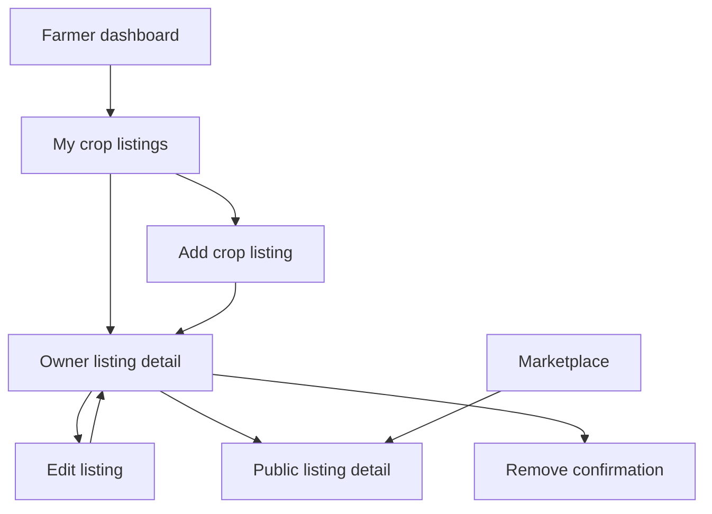
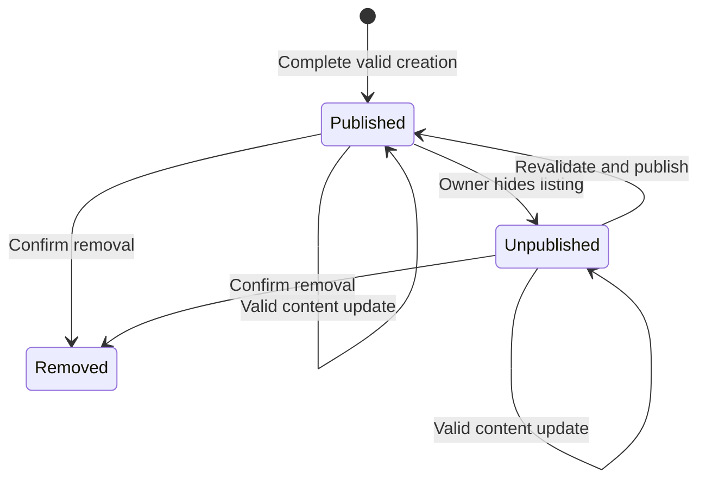
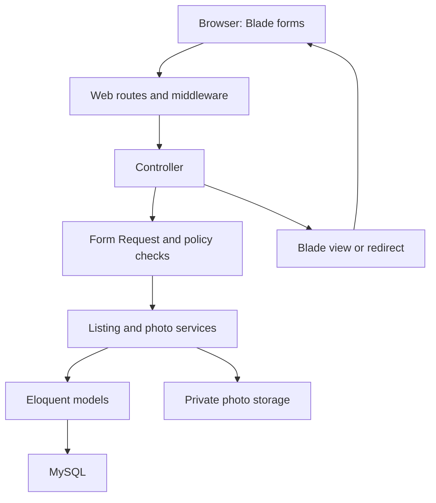
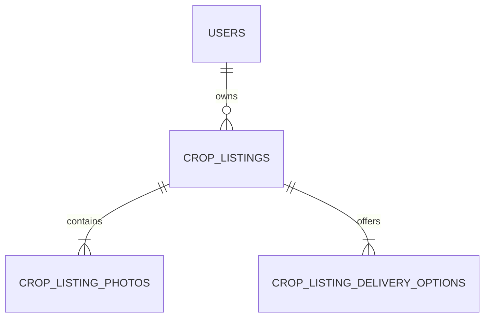

# F1 — Crop Listing Management

**Krishi Bondhu · CSE470 · BRAC University · Group 8**  
**Owner:** Emon (`emon/`) · **Sprint:** 1 · **Specification version:** 1.0 · **Prepared:** 13 November 2026

## 1. Purpose and how to use this document

This is the feature-level information architecture, interaction specification, Laravel MVC implementation contract, database design, security review plan, and acceptance-test plan for **F1 / R1**. Put it in the repository as `docs/features/F1-crop-listings.md`. The implementation prompt is in §22.

The intended result is straightforward: a farmer publishes a clearly described crop lot, sees how buyers will see it, and can update or remove it safely. A buyer can read published listings without signing in. Purchasing is a different feature.

This specification was prepared from the nine supplied repository documents: `project-context.md`, `architecture.md`, `design-system.md`, `IA.md`, `srs.md`, `workflow.md`, `first-time-setup.md`, `third-party.md`, and `ai-usage.md`, plus the research in §23. Actual application source code was not supplied for this review. The implementer must inspect the current checkout before choosing exact component APIs, migration names, or integration points.

**Evidence labels:** “Existing” means documented in those files; “Required” means the F1 SRS requirement or an existing project constraint; “Proposed” means a design decision introduced here. Proposed limits and supporting behaviors are not faculty requirements or results of farmer interviews. No application penetration test, usability test, or performance test has been executed as part of this document.

### Review perspectives

| Perspective | Responsibility in this feature |
| --- | --- |
| Product and information architect | Scope, vocabulary, navigation, ownership, interaction states, and cross-feature boundaries |
| Agriculture-focused UX and accessibility designer | Mobile use, Bangla, comprehensible units, photography, forms, and error recovery |
| Laravel backend and application-security engineer | Authorization, validation, state transitions, file handling, consistency, and failure behavior |
| MySQL data engineer | Relationships, exact numeric storage, constraints, query plans, and maintainable migrations |
| Full-stack verification engineer | Independent acceptance tests, adverse cases, integration checks, and scrutiny of AI-generated code |

These are complementary review responsibilities, not claims that five human experts tested the product. A separate agronomist is not necessary for listing CRUD; do not introduce agronomic certification or automated quality claims without domain expertise.

## 2. Existing project constraints to preserve

| Area | Existing baseline |
| --- | --- |
| Application | One Laravel 13 / PHP 8.4 MVC application; Blade, plain JavaScript, custom CSS; MySQL 8.4 LTS / InnoDB / utf8mb4 |
| Build and runtime | No React, Next.js, separate API backend, CSS framework, npm, or Vite. File sessions/cache and synchronous queues are documented. Do not add infrastructure merely for F1. |
| Authentication | Existing session auth, phone/password login, `users`, `roles`, `role_user`; use `hasRole(Role::FARMER)`, not a new `users.role` field |
| Language | Existing `SetLocale`, `preferences.locale`, English text keys with `__('...')`, `lang/bn.json`; same URLs in both languages |
| Design | Existing `<x-layouts.app>` and `<x-ui.*>` components, tokens, light/dark themes, `/design-system`; actual component files define supported props |
| Navigation | Existing marketplace and farmer listing route names in `routes/modules/marketplace.php`; replace relevant `PlannedController` actions |
| Data | Separate local development/test databases; schema changes through new migrations |
| Team | One working branch such as `emon/f1-crop-listings`, starting from current `staging`; PR into `staging`, merge commits, no mandatory approval rule |
| Checks | `composer check`; preserve the existing route-map and account tests |
| Course | MVC and honest AI disclosure; students must understand their implementation; packages implementing assessed work require the applicable course approval |

The landing page, account flows, design system, and bilingual support already exist. Do not rebuild setup or redesign the whole product. The current workflow also asks the student to confirm an agent-performed merge; this document is not authorization to merge or release.

## 3. Research translated into decisions

| Evidence | Application to F1 | Limit of the inference |
| --- | --- | --- |
| GSMA’s AgriTech UX guidance addresses limited digital literacy, connectivity constraints, and older devices [S1]. | Use a short, grouped, server-rendered form; explicit labels and outcomes; optimize photographs; test on a real phone. | These are reasonable starting assumptions, not findings from KB farmer research. |
| W3C WAI recommends clear submission feedback and linked error summaries [S2]. | Preserve text on validation failure, identify each invalid field, and explain how to fix it. | This does not prove the entire product meets WCAG. |
| WCAG 2.2 target-size guidance defines a minimum with exceptions [S3]. | Retain KB’s stronger 48 px controls and at least 44 px targets. | Do not incorrectly describe 44/48 px as the WCAG 2.2 AA minimum. |
| Laravel documents Form Requests, policies, transactions, and storage abstractions [S4–S7, S10–S11]. | Keep validation, authorization, persistence, and rendering in distinct responsibilities. | The current checkout must confirm actual APIs and existing abstractions. |
| OWASP recommends layered upload defenses and authorization checks on each request [S8–S9]. | Check ownership on every mutation and photo read; validate and re-encode images; never expose an upload directory directly. | These controls reduce specific risks; they do not guarantee vulnerability-free code. |
| MySQL distinguishes exact decimals and explains composite-index leftmost prefixes [S12–S13]. | Store quantity/price exactly and index the queries this feature actually runs. | Performance targets below need measurement against representative data. |

**Product conclusion:** prioritize a trustworthy listing, understandable price per unit, safe editing, and fast photographs. Avoid charts, AI descriptions, ratings, verification badges, complex wizards, and speculative marketplace infrastructure in this sprint.

## 4. Scope and feature boundaries

### 4.1 Required F1 behavior

1. A farmer creates a listing with photos, quantity, price, quality, harvest date, and delivery options.
2. The server validates required details before publication.
3. A farmer lists, views, edits, and removes only their own crop listings.
4. Published information can be read through the existing public marketplace routes.
5. Every operation respects the existing design system, localization, authentication, and MVC structure.

### 4.2 Proposed supporting decisions for this implementation

| Decision | Default in this specification | Reason |
| --- | --- | --- |
| Form structure | One page with four named sections | Few enough fields to avoid wizard state and extra requests |
| Creation | Submit a complete listing directly as Published | No draft subsystem is required to validate before publication |
| Temporarily unavailable | Owner can unpublish and later republish a valid listing | Avoid deleting a listing merely to hide it briefly |
| Removal | Soft-delete; disappear from normal owner/public pages and photo access | Preserve future references without building a recycle bin |
| Photos | 1–5 JPEG/PNG photographs; first retained photo is cover | Useful listing evidence with a bounded upload cost |
| Trade units | `kg`, `tonne`, `piece`; quantity and price use the same unit | Explicit units without ambiguous local-unit conversion |
| Quality | Required plain-language quality description | No invented grading standard or unverified certification |
| Harvest | Actual harvest date, today or earlier in Asia/Dhaka | Sprint 1 sells harvested crops; advance harvest sales need separate requirements |
| Location | Required approximate public area; no street address or coordinates | Useful context without collecting unnecessary personal location data |
| Public browse | Published cards and detail pages, newest first | Minimum F1 visibility; advanced buyer search belongs to F2 |
| Crop vocabulary | Free-text crop name for F1; reuse an existing agreed catalog if one is already integrated | Avoid creating a competing catalog while F11 is being built |

These defaults can be revised with the team. If changing them, update this specification, validation, tests, and the relevant SRS scope note together. Do not silently interpret them as confirmed policies.

### 4.3 Explicit boundaries

| Feature / teammate area | F1 provides | F1 does not implement |
| --- | --- | --- |
| F2 crop search / bulk requests | Public listing read model and basic browse | Buyer price/location/quality filters, requests, bids, search engine |
| F3 negotiation | Public asking price per unit | Private minimum price, offers, counteroffers, agreement records |
| F4 delivery cost | Allowed arrangement codes and explanatory notes | Delivery provider booking, distance/fees, packaging/platform costs |
| F5 stock/orders | A listing’s current offered quantity | Reservations, checkout, overselling prevention, payments, order statuses |
| F6 cattle | Reusable project patterns only | Cattle models, routes, photo abstractions, or screens |
| F11 / F12 | A clear future crop/location mapping boundary | Market-price synchronization, maps, GPS, distance, duplicate shared catalogs |
| F24 | Existing language/theme support, small image variants, normal validation recovery | Autosave, offline queues, persistent unfinished forms, a new low-data preference system |
| F25 supplies | Possible visual patterns to share later | Generic polymorphic product schema, shared cart implementation, changes to teammate-owned product logic |

**Integration gate:** before changing marketplace routes, translations, shared styles/components, dashboard, or existing crop/location models, follow `docs/workflow.md` and identify overlap with teammates. A routine F1 design choice does not require repeated permission; a conflicting shared contract needs an explicit resolution.

## 5. Users, jobs, and access model

**Farmer’s job:** “Describe one crop lot accurately, publish it, and keep it current without losing my work.”  
**Buyer/visitor’s job:** “Understand what is available, how much it costs per unit, its condition, and the possible delivery arrangements.”

| Action | Guest | Signed-in non-farmer | Farmer owner | Other farmer |
| --- | --- | --- | --- | --- |
| Browse/read Published | Yes | Yes | Yes | Yes |
| View private owner list | Redirect to login | 403 | Own records only | Own records only |
| Create | Redirect to login | 403 | Yes | Yes, under their own account |
| View unpublished owner detail/photo | 404 on public/photo reads | 404 | Yes | 404 |
| Edit/update/unpublish/republish/remove | Redirect on protected owner routes | 403 for workspace access | Yes | 404 for another owner’s record |
| Read removed listing/photo | 404 | 404 | 404 in normal F1 UI | 404 |

An Administrator role alone does not receive an implicit F1 bypass. Administration has its own planned routes and policy decisions. A user holding Farmer plus another role still has normal farmer rights. Do not hard-code a single active role or use numeric role IDs.

## 6. Navigation and route contract

### 6.1 Feature map



Reuse the existing Marketplace header link. Connect the farmer dashboard card to `farmer.listings.index` through the smallest agreed change. No new top-level navigation section is needed.

### 6.2 Existing routes to implement without renaming

| Method | URI | Name | Controller action / behavior |
| --- | --- | --- | --- |
| GET | `/farmer/listings` | `farmer.listings.index` | `Farmer\CropListingController@index`; owner list |
| GET | `/farmer/listings/create` | `farmer.listings.create` | `create`; blank form |
| POST | `/farmer/listings` | `farmer.listings.store` | `store`; validate and publish |
| GET | `/farmer/listings/{listing}` | `farmer.listings.show` | `show`; owner detail and optional removal confirmation |
| GET | `/farmer/listings/{listing}/edit` | `farmer.listings.edit` | `edit`; existing values |
| PUT/PATCH | `/farmer/listings/{listing}` | `farmer.listings.update` | `update`; content save or explicit visibility operation |
| DELETE | `/farmer/listings/{listing}` | `farmer.listings.destroy` | `destroy`; confirmed soft-delete |
| GET | `/marketplace` | `marketplace.index` | `MarketplaceController@index`; basic published browse |
| GET | `/marketplace/crops/{listing}` | `marketplace.show` | `MarketplaceController@show`; public detail |

Proposed additional route, justified by protected image delivery:

| Method | URI | Name | Behavior |
| --- | --- | --- | --- |
| GET | `/crop-listing-photos/{photo}/{variant}` | `crop-listing-photos.show` | `CropListingPhotoController@show`; `variant` restricted to `thumb` or `display`; evaluate parent visibility/ownership before serving |

The photo route is shallow and belongs in the marketplace route module. Update `docs/IA.md` and route tests for this addition. Do not manually guess a new global route count: derive it from the actual application.

Use named routes everywhere. Keep `create` above the dynamic listing route. Scope route-model binding/policies to the authenticated owner where appropriate; binding by ID alone is not authorization.

### 6.3 Requests and responses

- Owner list: `?status=all|published|unpublished&page=N`; fixed page size 12; unknown status returns a friendly validation error. No user-controlled arbitrary sorting or page size.
- Public list: `?page=N`; fixed page size 12. Do not advertise F2 filters that are not implemented.
- Create: multipart POST with CSRF and `submission_token`.
- Content update: multipart POST with `_method=PATCH`, `operation=save`, CSRF, `version`, fields, and optional photo changes. This avoids native multipart PUT parsing differences.
- Visibility update: POST with `_method=PATCH`, `operation=unpublish|publish`, CSRF, `version`; no unrelated fields are accepted for this operation.
- Remove: POST with `_method=DELETE`, CSRF, `version`, and explicit `confirm_remove=1`.
- Success: Post/Redirect/Get to owner detail; removal redirects to owner list. The owner detail provides “View public listing” when published. This makes the existing architecture example the concrete post-create flow.
- Validation failure: Laravel’s normal redirect with errors/old text for web forms. Do not turn every form into a JSON API; JSON requests may receive framework-standard 422 errors.
- A stale edit receives a rendered 409 conflict response with submitted text and recovery instructions, not a silent overwrite. A stale version must also block delete/visibility changes.

## 7. Listing lifecycle



`Removed` means `deleted_at` is set; it is not a third stored status. Database status values are only `published` and `unpublished`.

- Published: visible publicly, including approved image variants.
- Unpublished: visible only through the owner workspace and owner-authorized photo reads. It remains a complete saved listing, not an unfinished draft.
- Removed: excluded from all ordinary queries and all image responses. There is no restore or permanent-delete UI in F1.
- Content edits preserve the current status. Only the explicit publish/unpublish operation changes visibility.
- Republishing rechecks required information and the existence of at least one usable photo. Invalid data never becomes public.
- `published_at` records first publication. Republishing does not bump a listing to the top; `updated_at` records later edits.
- No automatic Sold out, Reserved, Expired, Approved, or Rejected states. Quantity must remain positive; owners should unpublish when no crop remains. F5 will later define the stock lifecycle.

## 8. Screen-level information architecture

### 8.1 My crop listings — `farmer.listings.index`

Order of content:

1. Breadcrumb: Dashboard → My crop listings.
2. One H1, “My crop listings”; supporting sentence; primary “Add crop listing”.
3. GET filter chips: All, Published, Unpublished. Keep the selected filter in pagination links.
4. Responsive listing cards, ordered by `updated_at DESC, id DESC`.
5. Accessible pagination.

Each card shows cover thumbnail, crop name, text status badge, asking price **per unit**, offered quantity with unit, approximate area, and last-updated date. Link the title to the owner detail; expose “Edit” as a separate link without nesting buttons inside a clickable anchor. Removal is on the detail screen, away from frequent list actions.

Empty states distinguish “You have no crop listings” from “No unpublished listings”. The latter offers “Show all”; the former offers “Add crop listing”. Do not show invented sales totals, revenue, popularity, or quality-verification indicators.

### 8.2 Add crop listing — `farmer.listings.create`

Use the existing narrow form layout (maximum 720 px). On mobile all fields are single-column. Related quantity/unit controls may sit side by side only when labels and Bangla text still fit.

| Section | Fields and content | UX intention |
| --- | --- | --- |
| 1. Crop details | Crop name; quality description; actual harvest date | Identify the lot and honestly describe its condition |
| 2. Quantity and price | Quantity; unit; asking price per selected unit | Prevent a total-price versus unit-price mistake |
| 3. Photos | Required first photo; up to four additional photos; format/size guidance; previews where JS is available | Show the actual crop without requiring editing skills |
| 4. Location and delivery | Approximate public area; delivery arrangement checkboxes; optional arrangement notes | Explain practical handover choices without pretending delivery is booked |

At the bottom show a compact review sentence, e.g. **“You are offering 250 kg at ৳35 per kg.”** A JS-enhanced summary may update as the user types. It must not calculate a “checkout total” or include invented charges. Without JS, the visible field labels already convey the same contract.

Primary action: **Publish listing**. Secondary link: **Cancel**. Explain just above the button: “Your listing and crop photos will be visible to anyone.” Warn not to upload documents, faces, or private addresses as crop photos. Do not add a separate consent checkbox merely to repeat the button’s intent.

There is no draft button, forced tutorial, full-screen multi-step wizard, or mandatory preview request. A dirty-form navigation warning can enhance the form, but must be cleared on successful submit and must not claim autosave.

### 8.3 Owner listing detail — `farmer.listings.show`

Order: breadcrumb; flash success/conflict message; crop name and text status; primary Edit action; photos; price/unit and quantity; quality; harvest date; approximate area; delivery choices and notes; created/updated dates; visibility/removal controls.

Published: “View public listing” link and secondary “Unpublish”. Unpublished: explanatory alert and “Publish again”. On both: a separate danger area contains “Remove listing”.

The remove link reloads this same named route with `?confirm=remove#remove-confirmation`. Render a dedicated confirmation region with the crop name, consequences, Cancel link, and a clearly labelled final **Remove listing** form button. No mutation occurs on GET. The form sends `confirm_remove=1` and the current version. This works without JavaScript or a custom modal.

Confirmation text: “Remove this crop listing? It will disappear from your listings and the marketplace. This screen cannot restore it.” Do not claim the data is permanently erased.

### 8.4 Edit — `farmer.listings.edit`

Use the same form partial and validation rules as creation. Preserve existing values, including decimal precision, selected unit, checkbox options, and visible photos. Show current status and clarify that saving preserves visibility.

Existing photos have numbered labels and “Remove this photo” checkboxes. New photos append to the retained sequence. The first remaining photo is the cover; explain this rule. F1 does not need drag-and-drop ordering or a separate cover database flag. If an owner removes all photos without adding a valid replacement, reject the entire update.

Changing the unit updates the price label and summary immediately but **does not convert any quantity or price**. Display: “Unit changed. Check both quantity and price before saving.” The server validates the new pair. Avoid an untested conversion involving local units.

Primary action: Save changes. Cancel returns to owner detail. On a stale edit, show the latest version separately from the submitted values; let the user open the latest edit form in a new tab and copy intended changes. Do not silently replace the submitted version with the latest value and resubmit.

### 8.5 Public browse — `marketplace.index`

Reuse the site’s marketplace shell. Show published listing cards with the same clear price/unit, crop name, quantity, area, and thumbnail. Order by `published_at DESC, id DESC`. A farmer may receive a “Manage my listings” link. Visitors do not need an account to read.

No fake Buy now, Add to cart, Make offer, delivery quote, or seller-rating controls. If F2/F5 code already exists in current staging, coordinate and integrate with it rather than replacing it with this minimal version.

### 8.6 Public detail — `marketplace.show`

Order: marketplace breadcrumb; crop name; photo gallery; asking price per unit; offered quantity; harvest date; quality description explicitly labelled **“Described by the farmer”**; approximate area; allowed delivery arrangements; updated date.

Use the same presentation partials as owner detail where appropriate. Do not leak login phone, email, street address, internal storage paths, submission tokens, or future private minimum prices. Farmer identity display should reuse an existing public display-name contract; if none exists, use “Listed by a farmer” rather than publish account details by accident. No automated badge stating “Verified”, “Organic”, or “Safe”.

Public gallery: main image uses the display variant; other photographs initially appear as small links/thumbnails. A normal link to the image route remains functional without JS. JavaScript can replace the main image after selection. Preserve keyboard navigation and the selected-photo text; avoid autoplay or an external gallery dependency.

Unpublished, removed, and inaccessible records return a useful 404 page with “Back to marketplace”. Do not reveal which private state caused it.

## 9. Field and validation contract

All limits below are proposed product defaults. Keep shared values in an F1 configuration/constants location so validation, hints, and tests stay aligned.

| Input | Required / proposed rule | Storage and display |
| --- | --- | --- |
| `crop_name` | Required, trimmed Unicode text, 2–100 characters; no HTML interpretation | `VARCHAR(100)`; preserve user’s language; example “Potato — Diamant” / “আলু — ডায়মন্ড” |
| `quality_description` | Required, 5–500 characters; describe size, sorting, damage, moisture/condition as relevant | `VARCHAR(500)`; escaped plain text, user-declared |
| `harvest_date` | Required, strict ISO date on server; actual date ≤ today in Asia/Dhaka; no arbitrary season/freshness cutoff | `DATE`, not timestamp; do not timezone-shift the date |
| `quantity` | Required, positive plain decimal, max 1,000,000; up to 3 fractional digits | `DECIMAL(12,3)`; exact string handling |
| `unit_code` | Required allowlist: `kg`, `tonne`, `piece`; piece requires an integer quantity | `VARCHAR(10)`; localized label, stable code |
| `price_per_unit` | Required, positive plain decimal, max 1,000,000 BDT; up to 2 fractional digits | `DECIMAL(10,2)`; display using `x-ui.price` plus localized “per unit” |
| `public_area` | Required, 2–120 characters; approximate upazila/district description, not an exact address | `VARCHAR(120)`; e.g. “Shibganj, Bogura”; not geocoded |
| `delivery_options[]` | Required, 1–4 distinct allowed codes; reject unknown codes | Child rows, not comma-separated text |
| `delivery_notes` | Optional, max 300 characters; instructions/limitations, not a guaranteed fee | Nullable `VARCHAR(300)`; escaped plain text |
| `photos[]` | Effective final total 1–5; each ≤5 MiB; JPEG or PNG by validated content and allowed extension; decode must succeed | Private generated files, metadata rows; limits detailed in §14 |
| `remove_photo_ids[]` | Update only; distinct IDs belonging to this listing; reject forged or mismatched IDs | Never trust paths or another listing’s IDs |
| `version` | Required positive integer on every update/remove | Compare to current row under transaction lock |
| `submission_token` | Required UUID on create; generated in form; retained on failed validation | Uniqueness scoped to farmer; duplicate behavior in §13 |
| `operation` | Update allowlist `save`, `publish`, `unpublish` | Command input only; never a database attribute |

Proposed delivery codes and labels, aligned with F4:

| Code | Label | Meaning |
| --- | --- | --- |
| `pickup` | Buyer pickup | Buyer collects from an agreed place |
| `buyer_arranged` | Buyer arranges transport | Buyer organizes the carrier |
| `farmer_arranged` | Farmer can arrange delivery | Arrangement can be discussed; no fee promised here |
| `third_party` | Third-party delivery | An external provider may handle delivery; no provider integration implied |

### Numeric and language rules

- Use text inputs with `inputmode="decimal"` for quantity/price if necessary to support Bangla digits consistently. Server `prepareForValidation` normalizes `০১২৩৪৫৬৭৮৯` to ASCII digits and trims whitespace.
- Accept an ungrouped decimal such as `1250.50` or `১২৫০.৫০`. Reject commas, currency symbols, scientific notation, negatives, `NaN`, and extra fractional digits with a helpful format example. Never silently strip separators or round an invalid input into a valid price.
- Do not use binary floating-point calculations or `floatval` to store money. Eloquent decimal casts must preserve exact strings; formatting and future arithmetic must keep that contract.
- Unit and delivery codes remain ASCII in requests/database; labels translate. User-written crop/quality/area text is not machine-translated.
- The date control submits `YYYY-MM-DD`. Provide a visible example/fallback where the browser does not support native dates. Compute the actual-harvest maximum from Asia/Dhaka while leaving application timestamps in UTC.
- If a quality or crop taxonomy already exists, reuse it only after checking the teammate’s contract. Otherwise these text fields intentionally do not pretend to support canonical F2 filters. Introduce shared IDs in a coordinated later migration; do not add speculative lookup tables now.

## 10. Design-system, accessibility, and localization contract

| Concern | Implementation requirement |
| --- | --- |
| Shell | `<x-layouts.app>`; `narrow` on forms; existing skip link, header, theme switch, footer and font credit |
| Hierarchy | One `t-title-1` H1; section headings `t-title-2`/`t-title-3`; normal `t-body`; avoid large marketing heroes |
| Components | Existing page-header, fields, select, textarea, checkbox, card/media-card, badges, alerts, buttons, empty-state, price, Lucide icon components |
| Grouped choices | `fieldset.fieldset`, descriptive legend, existing `.check-grid` for delivery choices |
| Tokens | Semantic tokens only; keep existing white/gray-green/Paddy/Sprout system; no new theme, hardcoded hex, inline styles, or framework |
| Sizing | Existing 48 px controls, ≥44 px targets, visible focus; form spacing from shared tokens |
| Layout | Single-column at narrow widths; existing breakpoints/grid utilities; no horizontal page scroll at 320 CSS px |
| Photos | Card viewport 16:10, no decorative filters; full-detail photos show the crop without forced destructive cropping; width/height attributes prevent shifts |
| Errors | Linked summary above form, inline messages, labels, `aria-invalid`, appropriate `aria-describedby`; focus summary after enhanced validation failure |
| State feedback | Text with status color; persistent success flash, not only a disappearing toast; polite announcements for photo-selection changes |
| Keyboard | All controls and gallery links reachable; no drag-only interactions; no nested interactive controls |
| Languages | English and Bangla labels, hints, errors, confirmations, badges, status messages; `lang/bn.json` and existing Laravel translation convention |
| Bengali typography | Let labels and buttons wrap; retain Li Ador Noirrit/Inter Tight fallbacks and required font attribution; never truncate critical Bangla content |
| Theme/motion | Test light and dark; existing reduced-motion behavior; avoid progress animation without measurable progress |
| No JavaScript | Create, read, update, remove, status changes, filters, pagination, and file selection still work as normal server forms/links |
| Low data | Small card thumbnails; lazy loading below fold; do not preload all gallery display images; if the existing low-data hook is active use thumbnails until requested |

Do not assume `<x-ui.media-card>` already supports every gallery or form behavior. Inspect the implementation first. Keep crop-specific views/CSS/JS local. A truly reusable component addition needs its design-system example and documentation update in the same coordinated PR.

### Suggested microcopy for human review

| Context | English | Bangla draft |
| --- | --- | --- |
| Owner list | My crop listings | আমার ফসলের তালিকা |
| Create action | Add crop listing | ফসলের বিজ্ঞাপন দিন |
| Submit | Publish listing | বিজ্ঞাপন প্রকাশ করুন |
| Quality hint | Describe the crop’s size, sorting, and condition. | ফসলের আকার, বাছাই ও অবস্থা লিখুন। |
| Price | Price per kg | প্রতি কেজির দাম |
| Date error | Enter the actual harvest date. It cannot be in the future. | ফসল সংগ্রহের সঠিক তারিখ দিন। ভবিষ্যতের তারিখ দেওয়া যাবে না। |
| Photo loss after validation | Please select your new photos again. Your text is still here. | নতুন ছবিগুলো আবার বেছে নিন। আপনার লেখা রাখা হয়েছে। |
| Conflict | This listing changed after you opened it. Your changes were not saved. | আপনি খোলার পর বিজ্ঞাপনটি পরিবর্তন হয়েছে। আপনার পরিবর্তনগুলো সংরক্ষিত হয়নি। |

Reuse existing product terminology if it differs. Have a fluent Bangla speaker check clarity before merging; these are draft translations, not validated farmer-language research.

## 11. MVC architecture and code ownership



The diagram shows responsibilities, not Laravel’s precise dispatch sequence: a resolved Form Request authorizes/validates before the controller action executes. Authentication and request-size handling also occur before controller work.

| Responsibility | Proposed location | What belongs here |
| --- | --- | --- |
| Owner HTTP workflow | `app/Http/Controllers/Farmer/CropListingController.php` | Seven resource actions, calling policy/service, choosing response |
| Public reading | `app/Http/Controllers/MarketplaceController.php` | Published-only index/show, bounded queries |
| Photo reading | `app/Http/Controllers/CropListingPhotoController.php` | Parent visibility/owner check, fixed variant, safe image response |
| Create validation | `app/Http/Requests/StoreCropListingRequest.php` | Normalization, farmer authorization, field/file rules |
| Update validation | `app/Http/Requests/UpdateCropListingRequest.php` | Owner authorization and operation-specific allowlists |
| Remove validation | `app/Http/Requests/DestroyCropListingRequest.php` | Owner authorization, version, confirmation |
| Ownership rules | `app/Policies/CropListingPolicy.php` | View owner workspace, create, update, delete, publish/unpublish; public visibility is explicit |
| Data | `app/Models/CropListing.php`, `CropListingPhoto.php`, `CropListingDeliveryOption.php` | Relationships, casts, query scopes; SoftDeletes on listing |
| Write coordination | `app/Services/CropListingService.php` | Transactions, deduplication, versions, photo/delivery consistency |
| Image processing | `app/Services/CropListingPhotoService.php` | Bounded decoding, sanitized variants, storage and cleanup |
| Owner views | `resources/views/farmer/listings/` | `index`, `create`, `show`, `edit`, shared `_form`/photo inputs/confirmation partials |
| Public views | `resources/views/marketplace/` | Existing index/detail organization; reuse feature display partials |
| Feature assets | `public/js/crop-listings.js`, optional `public/css/crop-listings.css` | Page-scoped enhancements/styles using existing asset inclusion mechanism |
| Persistence | `database/migrations/`, `database/factories/` | New additive migrations; realistic test data |
| Maintenance | Feature-specific Artisan cleanup command | Private orphan-file reconciliation; dry-run first |
| Verification | `tests/Feature/CropListings/`, optional focused unit tests | Behavior/security/failure checks, not tests mirroring implementation |

Names are suggested, not permission to overwrite an existing class. Reuse an existing marketplace controller and view organization if staging already has one. Do not add generic repositories, event buses, CQRS, microservices, an abstract marketplace hierarchy, or an API resource layer without a demonstrated need.

Views contain presentation and safe route links, never SQL queries, ownership decisions as the only protection, or persistence. Controllers remain small. Services are justified here by image/database consistency and multi-row writes, not by a rule that every field needs its own service.

## 12. Database design

### 12.1 Relationships



The minimum-one child requirement applies to valid, non-removed listings and is enforced by the write service. A foreign key alone cannot enforce that minimum.

### 12.2 `crop_listings`

| Column | Type / constraints | Purpose |
| --- | --- | --- |
| `id` | Unsigned BIGINT primary key | Normal Laravel identity; not treated as an authorization secret |
| `farmer_id` | Unsigned BIGINT, non-null FK to `users.id`, restrict hard deletion | Authoritative owner, always from authenticated account |
| `crop_name` | VARCHAR(100), non-null | Listing crop/variety description |
| `quality_description` | VARCHAR(500), non-null | Farmer’s quality statement |
| `quantity` | DECIMAL(12,3), non-null | Current amount offered in `unit_code` |
| `unit_code` | VARCHAR(10), non-null | `kg`, `tonne`, or `piece` |
| `price_per_unit` | DECIMAL(10,2), non-null | BDT asking price per that same unit |
| `harvest_date` | DATE, non-null | Actual calendar date |
| `public_area` | VARCHAR(120), non-null | Approximate public location |
| `delivery_notes` | VARCHAR(300), nullable | Optional arrangement details |
| `status` | VARCHAR(16), non-null | `published` or `unpublished` |
| `published_at` | Nullable timestamp/datetime following repo convention | First publication in UTC; assigned server-side |
| `version` | Unsigned INT, non-null, default 1 | Monotonic optimistic-concurrency version |
| `submission_token` | CHAR(36), non-null | Create-request deduplication, not user-facing |
| `created_at`, `updated_at` | Existing Laravel timestamp convention | UTC audit timestamps |
| `deleted_at` | Nullable timestamp | Soft removal |

Add MySQL CHECK constraints for supported status/unit codes, quantity and price bounds, integral `piece` quantities, and `version >= 1`. Keep the same constraints in request/domain validation for useful errors. Date-versus-today validation belongs in application logic, not a time-dependent database CHECK. All SQL values remain bound parameters.

Use `UNIQUE(farmer_id, submission_token)` across removed and non-removed rows. Multiple legitimate lots with the same farmer/crop/date are allowed; do not apply a uniqueness rule to those business fields.

No duplicated farmer phone/name/email, calculated lot total, image BLOB/base64, remaining-stock copy, per-currency table, or cached sales counters. Currency is fixed BDT for this sprint; a redundant per-row currency column is unnecessary unless the existing product already requires one.

### 12.3 `crop_listing_photos`

| Column | Type / constraints | Purpose |
| --- | --- | --- |
| `id` | Unsigned BIGINT primary key | Photo route identity |
| `crop_listing_id` | FK, non-null | Parent listing |
| `position` | Unsigned INT, non-null | Stable ordering; lowest retained position is cover |
| `display_path` | VARCHAR(255), non-null | Relative generated path on the configured private disk |
| `thumbnail_path` | VARCHAR(255), non-null | Relative path to separately generated small image |
| `display_width`, `display_height` | Unsigned SMALLINT, non-null | Correct image aspect ratio/layout |
| `created_at`, `updated_at` | Timestamps | Normal model lifecycle |

`UNIQUE(crop_listing_id, position)` supports ordered reads and enforces one photo per position. Positions may have gaps after removal; append new photos after the largest retained position. No renumbering collision, `is_cover` boolean, or duplicate cover pointer is necessary. Derive thumbnail dimensions from the fixed resize policy/aspect ratio, or add actual dimensions only if the implementation needs them.

Store only sanitized JPEG variants; MIME can be a service invariant rather than another repeated column. Do not retain original client filenames or EXIF metadata. Paths are generated server-side and never accepted as request parameters.

Hard-delete FK behavior may cascade photo metadata if a future retention process explicitly purges a listing. Cascading database rows never deletes filesystem objects automatically; that process must coordinate both. F1 exposes no force-delete path.

### 12.4 `crop_listing_delivery_options`

| Column | Type / constraints | Purpose |
| --- | --- | --- |
| `id` | Unsigned BIGINT primary key | Straightforward Eloquent identity |
| `crop_listing_id` | FK, non-null | Parent listing |
| `method` | VARCHAR(24), non-null; allowlisted code CHECK | One allowed arrangement |

`UNIQUE(crop_listing_id, method)` prevents duplicates. No timestamps are necessary for this child set. A small surrogate ID avoids custom composite-primary-key behavior in Eloquent; it does not duplicate domain data. Four fixed translated options live in code/config, so a separate lookup table is unnecessary. Replace the small selected set atomically on a content update.

Use a foreign key to `crop_listings.id`; hard-delete cascade applies only to these child option rows if a future controlled purge runs. Soft-deleting a listing does not cascade anything.

### 12.5 Catalog and location integration decision

The text-based crop, quality, and area fields are deliberate Sprint 1 decisions. F1 is managing individual lots; it is not yet implementing F2’s structured search. They are not duplicate copies of a shared catalog because no such contract is confirmed in the supplied documents.

If the actual repository already contains a coordinated crop/location catalog used by F11/F12, stop before creating competing fields or models: adapt this data dictionary to reference those IDs, preserve useful variety/quality notes, and document the resolution. Do not simultaneously store authoritative ID and authoritative text for the same attribute. A later F2 quality filter needs a shared vocabulary and a data migration; substring search of arbitrary quality prose is not an equivalent feature.

## 13. Backend operations and concurrency

### 13.1 Create / publish

1. Session auth, CSRF, farmer policy, and the F1 write limiter apply.
2. The Form Request validates the UUID submission token, normalizes and validates all ordinary fields and incoming files, and checks the required delivery/photo inputs. An invalid replay still fails validation; it is not an endpoint for retrieving old results without a valid form submission.
3. Before image processing, look for a prior listing under **this farmer + token**, including soft-deleted rows. A valid repeat returns the existing result without creating or modifying a listing; show that the earlier submission was used. If it was removed, return a clear conflict instead of resurrecting it. After a connection failure, a user without the original file selections can check My crop listings instead of resubmitting.
4. Decode/process photos one at a time to unique private variant paths. No listing is public yet. Keep an explicit list of newly written paths for compensation.
5. In one short database transaction, insert the listing, photo rows, and distinct delivery rows; set owner, status Published, first publication time, and version 1 server-side.
6. A uniqueness race on the farmer/token constraint rolls back the losing transaction. Remove only that attempt’s new files, then find the winning listing. Do not swallow unrelated database errors as “duplicate success”.
7. On any other failure, roll back database work and remove the attempt’s new files. Log a diagnostic reference, not the entire request.
8. After commit, redirect to the owner detail with a clear success message.

The token is a deduplication key, not a security credential. The server renders a fresh token per new form and preserves it on validation failure. A replay with altered fields never updates the original listing; edit uses the normal update route. CSRF, authentication, ownership and rate limits remain necessary. PRG and a disabled submit button alone do not guarantee duplicate protection.

### 13.2 Edit / save

1. Authorize the owner before performing expensive image processing. Validate submitted fields and provisional photo changes.
2. Process new files to new private paths before opening the database transaction. Never overwrite existing file paths.
3. In the transaction, reload the non-removed listing with `lockForUpdate`, verify the owner/current eligibility and compare submitted `version` with the persisted value.
4. If versions differ, roll back, remove new attempt files, return 409 and preserve submitted text for review. Do not perform a last-write-wins update.
5. Under the same lock, verify every retained/removed photo belongs to this listing; recompute the final 1–5 photo count; update scalar fields, photo rows, and the delivery set; keep visibility; increment version exactly once.
6. Commit. Only then delete files belonging to removed photo rows. A cleanup failure is logged and reconciled later; it must not report that the committed content update failed.
7. Redirect with success. Other readers see the old complete listing or the new complete listing, not an intermediate child set.

Keep disk operations out of retried transaction closures. If the implementation enables transaction retries, the closure must have repeatable database-only behavior. Use a consistent parent-first locking order.

### 13.3 Visibility / removal

- Unpublish: authorize, lock, compare version, change status, increment version, commit. New public page/image requests must fail after this change.
- Republish: same sequence, but validate the stored content/options and the existence of usable image variants before changing status. Handle missing storage as a recoverable repair problem.
- Remove: authorize, validate explicit confirmation, lock/compare version, set `deleted_at`, increment version, commit. Never cascade-delete a user or future order from this operation.
- A repeated action with an old version is a conflict, not an authorization shortcut. A removed record normally resolves to 404.
- F1 soft removal retains private records/files. It is not a data-erasure mechanism. Before public deployment, agree a retention/purge policy and a process that preserves any future order references. Orphan cleanup below does not purge intentionally retained removed records.

### 13.4 Future F5 integration contract

Today `quantity` means farmer-declared quantity offered. It is not a stock ledger and does not prove stock is reservable. When F5 arrives, all quantity changes, reservations and cancellations must share a transaction/locking or atomic-update contract, and every writer must update the concurrency version. Reject reductions below committed/reserved obligations using F5’s actual model. Preserve order-item snapshots of agreed price/unit/details; do not let listing edits rewrite historical purchases.

If F5 is already present in the live checkout, this integration is a blocker to using unrestricted F1 quantity edits. Do not “leave it for later” in a repository that already accepts orders.

## 14. Photo safety and storage lifecycle

The proposed limits implement a bounded F1 upload pipeline. OWASP’s layered upload guidance informs this design [S8]; the exact sizes and variants are KB design choices.

1. Allow JPEG/PNG only, maximum **5 MiB each**, maximum **5 final photos**, maximum **6,000 pixels on either side and 12 million total pixels** per image. Check headers/dimensions before full decode; corrupted/truncated input still must fail safely at decode. Explain rejected phone photos rather than silently discarding them.
2. Reject SVG, GIF, HEIC, PDFs, archives, remote URL imports, MIME/extension mismatches, and malformed uploads. Provide “Export as JPG or PNG” guidance for unsupported formats. The browser’s `accept` attribute is a hint, not validation.
3. Use an existing approved image processor if present. Otherwise implement a small, tested PHP GD pipeline, with JPEG/PNG support; use an available EXIF facility for camera orientation before stripping metadata. Verify required PHP extensions on Windows, CI, and hosting. Do not add a third-party media package or assume extensions are installed.
4. Process one image at a time. Limit decode dimensions, memory and execution time; free buffers. Re-encode to fresh JPEG variants, flatten transparency onto a neutral background, correct orientation, and omit metadata/GPS. Do not serve the uploaded original. Test rotated camera images and transparent PNGs explicitly. Dimension inspection alone is not image validation, and a successful GD return value alone is not proof that a usable output file exists: check nonempty output and its expected format/dimensions [S14–S15].
5. Proposed display image: longest edge ≤1,600 px; thumbnail: longest edge ≤480 px; no upscale. JPEG quality around 82/75 is a starting point, to be tuned with real crop texture. Aim for thumbnails ≤100 KiB and display images ≤450 KiB; these are measurement targets, not guaranteed output sizes.
6. Generate unpredictable filenames in an F1-owned private directory. Never concatenate request filenames or route paths into filesystem paths. Keep files outside `public/` and outside the `public/storage` symlink.
7. Photo reads load the photo’s parent and enforce current publication/ownership, including soft-delete checks. Only `thumb` and `display` variants exist. Return the correct fixed image MIME and `X-Content-Type-Options: nosniff`.
8. Use `Cache-Control: private, no-store` for these image responses in this first version so a subsequent request cannot reuse a publicly cached image after unpublishing. A future CDN/cache strategy must explicitly handle revocation. Images already downloaded or screenshotted cannot be recalled.
9. Keep new files private until database commit makes them reachable. Rollbacks/conflicts remove newly written files; successful replacement removes old files only after commit. Storage writes must throw/report failures, not yield a “successful” empty path.
10. Add an F1-only orphan cleanup command with dry-run default: examine paths older than 24 hours, compare against photo references **including soft-deleted listing references**, and remove only unreferenced files inside the dedicated F1 directory. Never delete another feature’s uploads. Run manually during development; document scheduler activation for hosting rather than assuming a worker exists.

PHP/web-server upload settings must support the documented form envelope: `upload_max_filesize` at least 5 MiB, `post_max_size` and reverse-proxy body limit comfortably above five files plus multipart overhead (e.g. 32 MiB), and `max_file_uploads` at least 5. The application still enforces its own tighter per-file/count limits. Ensure oversized requests get a readable response even when PHP rejects them before Laravel receives form data.

Do not create a complicated persistent upload-staging API for this sprint. New browser file selections may have to be selected again after server-side validation failure; explain that honestly. Existing stored photos must remain untouched until a valid update commits. If memory/runtime checks cannot support these limits, lower them consistently and document the measured reason instead of weakening image validation.

## 15. Query performance and operational behavior

### 15.1 Start with indexes tied to real queries

| Query | Proposed supporting index / method |
| --- | --- |
| Owner list ordered by recent edit | `crop_listings(farmer_id, deleted_at, updated_at, id)` |
| Public list ordered by first publication | `crop_listings(status, deleted_at, published_at, id)` |
| Create deduplication lookup | Unique `(farmer_id, submission_token)` |
| Ordered images / cover | Unique `crop_listing_photos(crop_listing_id, position)` |
| Delivery methods | Unique `crop_listing_delivery_options(crop_listing_id, method)` |
| Individual detail | Primary key plus explicit owner/visibility predicate |

The owner status filter initially uses the owner-list index with a residual status check. Do not add another wide index automatically for a farmer with a small number of records. Compare `EXPLAIN` on representative data before adding one. MySQL composite indexes depend on their leftmost columns [S13]; a public index does not replace the owner-list index.

- Inspect the migration result for duplicate single-column FK indexes already covered by the selected composite index. Keep indexes required by foreign keys; remove only proven redundancy.
- Use SQL pagination at 12 items, never `get()->paginate()` or loading the entire table into PHP. Offset pagination is adequate for the course dataset; keyset pagination is a measured future change.
- Eager-load the cover relation rather than query in a Blade loop. Define a stable one-of-many cover relation or fetch only required covers in one bounded query. Listing cards do not need all full-size images or every child row.
- Load the photo set and delivery set for detail in bounded relationship queries. Avoid unrelated account relationships and `SELECT *` when only a few public fields are needed.
- Display price strings through the existing price component; avoid deriving and persisting totals.
- Do not cache private listing collections or introduce Redis/full-text search for F1. Render current public visibility from the database; public HTML should revalidate rather than be served from an uncontrolled full-page cache.
- Keep API calls and image processing out of transactions. This feature needs no external API.

### 15.2 Proposed measurement targets, not claims

Use a reproducible local/CI benchmark dataset of roughly 10,000 listings across many farmers, several status distributions, and 1–5 photos each. Seed synthetic data only in the designated test/performance database.

| Target | Measurement method |
| --- | --- |
| No N+1 growth | Compare feature query counts for 1 and 12 cards; count stays bounded (aim ≤4 feature data queries for list, excluding auth/session/role queries) |
| Efficient access | `EXPLAIN`/`EXPLAIN ANALYZE` owner/public queries; explain residual scans and sorting, measure at realistic cardinality |
| Responsive pages | Warm non-upload application requests: target p95 <500 ms on a documented local baseline; record hardware, dataset, and cache state |
| Lean card images | Inspect network requests; only thumbnails on index, no hidden display-image downloads |
| Mobile usability | Test 360/390 px widths, 200% text zoom, slow-network simulation, and a real phone when available |
| Stable uploads | Test five maximum-allowed images and observe memory/time; publish only if the entire save succeeds |

No benchmark number is a production guarantee. Prioritize correctness and bounded work before tuning. Host storage needs capacity monitoring/quotas: rate limiting alone does not prevent disk exhaustion over time.

## 16. Threat model and security acceptance conditions

| Risk / attack | Required control | Evidence expected before merge |
| --- | --- | --- |
| Change another farmer’s listing ID | Owner-scoped policy on every owner route and write; consistent not-found response | Farmer B cannot view private/edit/update/delete A’s listing |
| Attach/remove someone else’s photo | Verify photo parent under the locked listing; never accept paths | Forged photo IDs rejected, both listings unchanged |
| Submit a forged owner/status/publication time | Explicit validated mapping; owner and system fields assigned server-side | Payload with `farmer_id`, `deleted_at`, `published_at`, arbitrary status cannot alter them |
| CSRF / deletion by link | Existing web middleware, CSRF token, correct mutation methods; no exemptions | Real middleware/browser test rejects forged write; GET has no side effect |
| Stored XSS through crop/quality/notes | Escaped Blade text, no raw `{!! !!}` for user content; safe JS text insertion | Script/HTML payload is displayed harmlessly or safely rejected |
| SQL injection / query abuse | Eloquent/bound values, allowlisted filters and variants, fixed pagination size | Malformed filters cannot create arbitrary SQL/order clauses or unbounded reads |
| Malicious or oversized image | Content/decode checks, bounded resources, re-encoding, private generated paths | Wrong type, corrupt file, oversized dimensions/bytes all fail with no partial listing |
| Previously public photo accessed after hiding | Parent state checked for every photo request; no static public URL or shared cache | Previously copied photo URL becomes 404 after unpublish/remove |
| Duplicate request after weak connection | Farmer/token unique constraint and deterministic replay handling | Two requests create exactly one parent and one valid child set |
| Two tabs editing the same listing | Row lock plus submitted version comparison | Second stale update returns conflict and does not overwrite the first |
| Unauthorized repeated writes / resource abuse | Proposed limit: 10 create attempts/minute/account and 30 update/delete attempts/minute/account; bounded uploads and host capacity control | 429 response is readable; rejected request does not process/store images |
| File/database partial failure | Compensation, after-commit deletion, orphan reconciliation | Forced storage/DB failures preserve the old valid record or leave no new public record |
| Personal data leakage | Explicit public fields; strip EXIF; avoid account phone/email; approximate area only | Response/body/image metadata inspection |
| Excessive error detail | Production debug off, safe generic errors, restricted logs | No SQL, filesystem paths, secrets, or stack traces shown to users |

Keep existing password/session security. Deployment should use HTTPS and appropriate secure session-cookie settings; F1 must not replace authentication or weaken CSRF to make uploads work. Logs may include actor ID, listing ID, operation, result and a correlation ID, but should omit tokens, image content, and complete personal text. Do not introduce a full audit-event subsystem solely for this feature.

## 17. Failure and recovery design

| Situation | User experience | Data behavior |
| --- | --- | --- |
| Required field missing | Summary and field error, text retained, focus moved meaningfully | No new/changed database record |
| New photo rejected | Identify photo number/reason; ask to select new files again | Existing photos remain unchanged |
| Request too large | Explain upload limit and return path; do not claim text/files were recovered if PHP discarded them | No partial publication |
| Connection lost during submit | Explain uncertainty when detectable; direct user to My crop listings before starting another new listing | Same-token retry returns original result if commit succeeded |
| Storage full / decode failure | Safe message with retry guidance, no false success | Database remains old/empty; attempt files cleaned or queued for reconciliation by command |
| Session/CSRF expiry | Clear session-expired sign-in path; avoid raw technical error page where possible | No mutation; persistent form recovery is not promised by F1 |
| Listing edited elsewhere | 409, submitted text preserved in response, latest edit link | No lost update |
| Listing removed elsewhere | Not-found/conflict guidance to owner list | No resurrection |
| Existing image missing | Tinted placeholder on reads and owner repair guidance | No fatal page error; republish blocked if no usable photo remains |
| Post-commit old-file deletion fails | Save still succeeds; internal cleanup warning | New record valid; orphan remains private until reconciled |
| Rate limited | Explain temporary limit, respect Retry-After | No upload processing or write |

No “Saved offline”, “Automatically recovered”, or “Delivery confirmed” message unless the corresponding behavior actually exists. Feature-specific JavaScript should preserve file selections while its own client-side validation runs, but normal server redirects cannot repopulate file inputs.

## 18. Acceptance tests and evaluation plan

This is a test plan. Mark each item Pass/Fail/Blocked with actual evidence during implementation. Do not pre-fill it as passed.

### 18.1 Automated feature and integration cases

| ID | Behavior to verify | Expected result |
| --- | --- | --- |
| F1-T01 | Valid farmer creates with all required fields and 1 photo | One Published listing, correct owner, delivery/photo rows, public page available |
| F1-T02 | Each required input absent/blank; bounds and decimal precision tested separately | Field-specific errors; no partial save |
| F1-T03 | Bangla text/digits and English text/digits | Numeric values normalized exactly; text preserved; UI localized |
| F1-T04 | Price 0/negative, exponent, commas, extra precision; fractional `piece` quantity | Rejected without rounding/coercing into success |
| F1-T05 | Harvest date at Dhaka midnight boundary and a future date | Correct local calendar rule while DB timestamps remain UTC |
| F1-T06 | Guest and non-farmer access | Guest redirects on owner routes; role restriction enforced; public reads remain available |
| F1-T07 | Farmer B targets every owner read/write operation on A’s record | No access/mutation; ownership protected consistently |
| F1-T08 | Forged owner/system fields and unknown operation/code | Rejected or excluded by explicit mapping; persisted system values correct |
| F1-T09 | Edit fields without new photos | Existing photos and status preserved; version advances |
| F1-T10 | Remove some photos, replace all with valid new photo, remove all without replacement, exceed count | Valid final sets commit; invalid final sets leave old record intact |
| F1-T11 | Foreign photo ID, duplicate removal IDs, unknown variant/path input | Safe rejection; no cross-listing data/file changes |
| F1-T12 | Unpublish, public detail/photo request, republish | Public reads fail while hidden; valid republish restores reads; first publication timestamp preserved |
| F1-T13 | Missing required stored content/image at republish | Remains unpublished with repair guidance |
| F1-T14 | Remove with missing confirmation, wrong owner, stale version, valid confirmation | Only valid owner/current-version confirmation soft-deletes |
| F1-T15 | Soft-deleted record/photo requested through every route | Excluded from normal queries; no public/static photo bypass |
| F1-T16 | Two edit tabs; first saves then second submits old version | Second conflicts, first changes intact |
| F1-T17 | Two same-token creates, including concurrent requests | Exactly one listing and valid child set; losing files cleaned |
| F1-T18 | Storage write, image decode, DB insert/update, and post-commit deletion failures | Required compensation behavior from §13–14 |
| F1-T19 | HTML/script payload in text fields | Escaped output, no execution in page or preview JS |
| F1-T20 | JPEG/PNG valid, corrupt image, masquerading PHP/SVG, size/dimension/pixel limits, rotated photo | Only valid sanitized images stored; orientation correct, metadata removed |
| F1-T21 | Pagination/filter ordering with same timestamps, multiple farmers and hidden/removed records | Stable order; correct scope; no duplicates caused by joins |
| F1-T22 | More cards/related rows | Query count remains bounded; no Blade N+1 |
| F1-T23 | CSRF and write throttling with middleware truly active | Forged write rejected; rate limit works |
| F1-T24 | Cleanup dry-run/apply with old orphan, active file, recently staged file and removed-record reference | Deletes only eligible old F1 orphans; unrelated files untouched |
| F1-T25 | Existing account, locale, dashboard and route-map suite | Still passes; newly protected pages have appropriate guest expectations |

Use the real MySQL 8.4 test database for constraint/decimal/locking behavior; SQLite-only tests cannot establish those guarantees. Use `Storage::fake` for ordinary filesystem behavior and targeted real temporary-image tests for decoding/metadata. Add real failure injection for file writes and database transactions.

Laravel test execution may bypass CSRF or wrap tests in transactions: verify that CSRF tests actually enable the protection, and that post-commit cleanup/concurrent-request tests actually commit. Sequential old-version tests prove stale-edit behavior; they do **not** prove race handling. Concurrency tests need separate database connections/processes and deterministic coordination. Never run destructive test migrations on a developer’s working database.

### 18.2 Manual UX and accessibility checks

Test each form and detail/list state in English/Bangla and light/dark themes. Include keyboard-only use, one screen reader if available, 320/360/390 px widths, a desktop width, 200% text zoom, no-JS mode, slow network, empty lists, five images, long crop names, and multi-line Bangla errors.

Ask approximately 3–5 representative farmers if feasible; otherwise explicitly label participants as student proxies. Give tasks without coaching: publish a sample lot, explain what the displayed price means, correct a quantity, hide the listing, and remove it. Record completion, misunderstandings, assistance, and error recovery rather than claiming statistical significance. A reasonable initial usability goal is at least 4 of 5 participants completing the main publishing task unassisted, with **no unresolved price/unit misunderstanding**. Do not treat this small sample as proof of general usability.

### 18.3 AI-generated code review gates

The reviewer should read the diff against this contract, then try to disprove it with independent tests. A generated test that simply repeats generated code is weak evidence.

**Block merging if any of the following is present:**

- Farmer identity/status taken from untrusted payload, missing policy checks, direct public upload storage, or a private photo readable by URL.
- Money converted through binary floating point, unsupported unit conversion, or silently rounded invalid inputs.
- Deletes/updates performed before version/ownership checks; transaction-safe DB code paired with unsafe file side effects.
- `request()->all()` mass assignment; raw user HTML; user-controlled paths/query column names.
- Tests weakened to accept a failure, broad exception catches returning success, fake benchmark numbers, or claims of testing not actually performed.
- New frameworks/packages/infrastructure, changed auth behavior, teammate code overwritten, or invented design-system component APIs.
- F2/F3/F5/F24/F25 silently marked complete because F1 shares a route or visual pattern.

**Human viva check:** Emon should be able to trace one create request through middleware, Form Request, policy, service, model, transaction, and view; explain why a photo is private; explain decimal types, indexes, stale edits, and what happens when a storage write fails. Record AI assistance honestly in `docs/ai-usage.md`.

## 19. Implementation order and team integration

Sprint 1’s supplied deadline is 14 November 2026. Keep the implementation incremental and demonstrate the required CRUD path early; do not use deadline pressure to omit ownership or upload safety.

1. **Inspect and reconcile.** Read repository instructions and actual code; confirm F1 issue/branch and baseline tests. Identify existing shared crop/location/order models, route ownership, component APIs, image extensions, and any conflict with this proposal.
2. **Data and permissions.** Add additive migrations, models, policy, request rules, factories, and authorization/validation tests. Do not edit migrations already merged/run by teammates.
3. **First complete vertical slice.** Build create → publication → owner detail → public detail, with safe image processing and clear fields. Reuse design components from the start.
4. **Complete management.** Owner list, edit, photo replacement, remove, versions/deduplication, and recovery. Add the proposed unpublish/republish behavior after required CRUD is working.
5. **Public browse and integration.** Implement only the minimum F1 browse surface; preserve teammates’ work. Add the photo route, small agreed dashboard link, translations, and route-map updates.
6. **Verification and polish.** Run adversarial/failure tests, `composer check`, the manual matrix, and measured query/image checks. Fix material defects. Record which checks could not run.
7. **Reviewable PR.** Update docs/AI disclosure/SRS evidence honestly; prepare PR into staging using current workflow. Mark F1 complete only when required acceptance criteria pass. No release-to-main work belongs to this feature task.

Proposed commit-sized slices: “Add crop listing schema and owner policies”; “Publish validated crop listings with safe photos”; “Add crop listing editing and removal”; “Add marketplace listing views and translations”; “Verify crop listing failure and concurrency behavior”. Each pushed slice should be understandable; use a draft PR for incomplete work.

If the full supporting proposal will not fit, retain the required create/read/edit/remove/validation path and security controls. Unpublish/republish, additional unit choices, and optional JS refinements can be explicitly deferred with the spec and UI adjusted. Do not leave buttons for unimplemented behavior.

## 20. Documentation changes expected in the implementation PR

| File | Change |
| --- | --- |
| `docs/features/F1-crop-listings.md` | Store this spec; record resolved deviations and evidence |
| `docs/IA.md` | Mark implemented controller routes, add the photo route, clarify post-create owner-detail flow |
| `docs/srs.md` | Assign/update F1 only; distinguish Planned/In progress/Done and completed sprint accurately; note material scope decisions |
| `docs/architecture.md` | Add F1’s actual models/services/photo flow only if useful; preserve whole-app MVC |
| `docs/design-system.md` | Only for a coordinated new reusable component, with `/design-system` example |
| `docs/first-time-setup.md` / `.env.example` | Required PHP image extensions, image limits/storage setup and safe configuration placeholders, if new |
| `docs/third-party.md` | Any approved added dependency; no fabricated package use |
| `docs/ai-usage.md` | What the assistant actually helped with and what Emon reviewed/understands |

Shared-document edits should be narrow and merged carefully with ongoing teammate work. There is no need to rewrite the entire project context or global IA for one feature.

## 21. Design review outcome and remaining uncertainties

The design covers each F1 SRS item: create/view/edit/remove; photos; quantity; price; quality; harvest date; delivery options; and server validation before publication. It preserves the existing nine business routes and proposes one controlled photo route. It uses three feature tables plus the existing users table and adds no new runtime service.

The most significant deliberate tradeoffs are a single non-autosaving form, free-text crop/quality/approximate area until shared catalogs are agreed, harvested crops only, and private image responses with conservative caching. These keep the sprint manageable while making the boundaries explicit.

**Resolve by inspecting current code first:** shared marketplace/crop/location work; whether order reservations already exist; exact component props; available image-processing extensions; existing error-page conventions; current tests and branch state. **Validate with people/measurements:** unit choices and terminology, Bangla copy, photo limits on common phones, quality-description clarity, and performance targets. **Before public deployment:** hosting disk persistence/capacity, backup/retention policy, HTTPS/session settings, production debug configuration, and cleanup scheduling.

No unknown here justifies inventing an existing API or claiming successful tests. When a decision depends on absent code or conflicting teammate work, state the specific missing contract and continue independent F1 work where safe.

## 22. Prompt to use in the coding agent

Copy the following after adding this file as `docs/features/F1-crop-listings.md`:

```text
I am Emon (branch prefix emon/). My task is Sprint 1 F1 / R1: Crop Listing Management.
Implement F1 in this existing Krishi Bondhu repository, using
docs/features/F1-crop-listings.md as the proposed feature specification.
F6 is my next feature; do not implement it now.

Start by reading AGENTS.md, CONTRIBUTING.md, docs/workflow.md,
docs/project-context.md, docs/architecture.md, docs/design-system.md,
docs/IA.md, docs/srs.md, docs/first-time-setup.md, docs/third-party.md,
docs/ai-usage.md, and the F1 specification. Then inspect the actual source,
composer.lock, routes, auth/Role model, components, translations, migrations,
tests, and current branch/worktree. Current source and documented team
contracts must be reconciled with the proposal before implementation.

The task itself is confirmed: F1. Find/reuse its existing issue if available;
do not invent an issue number or teammate assignment. Follow the session and
branch workflow. Preserve unrecognized or teammate changes. Do not reset,
force-push, rewrite shared migrations, or run destructive commands against
the development database.

Keep Laravel MVC, Blade, the existing custom design system, plain JS, and
MySQL. Do not rebuild setup, auth, the landing page, or the global design.
Inspect component APIs instead of guessing props. Keep existing F1 URI/route
names. Coordinate shared-file changes as the workflow requires. Do not add
frameworks, packages, workers, Redis, or a separate backend without the
required project decision. Check available PHP image extensions first.

Before editing, report a concise implementation map: files touched, existing
contracts reused, proposed decisions adopted, and any concrete conflict or
dependency. Make routine reversible choices within the authorized F1 scope;
ask only where a missing decision materially changes scope, shared contracts,
or required course/team approval. Continue independent work while resolving
such a dependency.

Build in small, understandable vertical slices. Implement owner-authorized
CRUD, server validation before publication, private sanitized photo storage,
safe multi-row writes, exact numeric handling, duplicate-submit protection,
stale-edit protection, bilingual accessible views, and bounded queries as
specified. Add supporting visibility controls only as documented. If current
staging already has order/stock or shared catalog logic, integrate with its
real contract; never overwrite or bypass it.

Keep F2 advanced search, F3 negotiation, F4 fee calculation, F5 ordering and
reservations, F6 cattle, F24 autosave/offline behavior, and F25 product logic
outside this change. Do not add fake commerce buttons or claim those features
are complete. Keep layouts, colors, fonts, spacing, component behavior,
light/dark themes, and English/Bangla text consistent with the existing app.

Test against the specification's observable behaviors, including ownership
attacks, forged photo IDs, upload failures, stale edits, duplicate creates,
public image revocation, and decimal/date boundaries. Use the designated
MySQL test database. Run composer check and appropriate real image/concurrency
tests. Check no-JS behavior, mobile widths, keyboard access, light/dark,
English/Bangla, error states, query count and image payloads. Never claim a
browser, security, performance, or concurrency test passed unless it ran.

Perform a final adversarial review of your own diff independently of the
generated tests. Fix material issues; do not weaken assertions to pass.
Update relevant living docs and AI disclosure, keeping status honest. Explain
the important code paths so I can understand and defend them in the viva.

Finish with: what changed; files and routes; migrations/setup needed; tests
actually run and results; untested items/risks; deviations from the spec;
and a reviewable PR description for staging. Follow the repository's current
student-confirmation rule before an agent-performed merge. Do not release
to main or deploy as part of this request.
```

## 23. Research references

Consulted 13 November 2026. These are primary sources. The specific F1 schema, limits, screens, and tradeoffs are design proposals in this document, not prescriptions copied from the sources. GSMA’s resource/announcement was available through search retrieval; direct page opening returned an access error, so this document does not claim to have reviewed the complete guidebook PDF.

| ID | Source | Relevance |
| --- | --- | --- |
| S1 | [GSMA — Introducing the AgriTech UX Design Guidebook](https://www.gsma.com/solutions-and-impact/connectivity-for-good/mobile-for-development/blog/introducing-the-agritech-user-experience-ux-design-guidebook/) and [resource overview](https://www.gsma.com/solutions-and-impact/connectivity-for-good/mobile-for-development/gsma_resources/agritech-ux-design-guidebook/) | Agricultural UX, low digital literacy and connectivity context |
| S2 | [W3C WAI — User Notifications](https://www.w3.org/WAI/tutorials/forms/notifications/) | Clear feedback, linked errors, field association |
| S3 | [W3C — Understanding SC 2.5.8 Target Size (Minimum)](https://www.w3.org/WAI/WCAG22/Understanding/target-size-minimum.html) | Accurate interpretation of accessible target sizing |
| S4 | [Laravel 13 — Validation](https://laravel.com/docs/13.x/validation) | Form Requests, input preparation, validation errors |
| S5 | [Laravel 13 — Authorization](https://laravel.com/docs/13.x/authorization) | Policies and resource-level access decisions |
| S6 | [Laravel 13 — File Storage](https://laravel.com/docs/13.x/filesystem) | Private versus public storage and filesystem operations |
| S7 | [Laravel 13 — CSRF Protection](https://laravel.com/docs/13.x/csrf) | Web request forgery protection |
| S8 | [OWASP — File Upload Cheat Sheet](https://cheatsheetseries.owasp.org/cheatsheets/File_Upload_Cheat_Sheet.html) | Layered validation, resource limits, safe storage and image rewriting |
| S9 | [OWASP — Authorization Cheat Sheet](https://cheatsheetseries.owasp.org/cheatsheets/Authorization_Cheat_Sheet.html) | Deny-by-default, per-request checks and authorization testing |
| S10 | [Laravel 13 — Database](https://laravel.com/docs/13.x/database) | Transaction boundaries and database behavior |
| S11 | [Laravel 13 — Query Builder, pessimistic locking](https://laravel.com/docs/13.x/queries#pessimistic-locking) | Transactional row locking |
| S12 | [MySQL 8.4 — Fixed-Point Types](https://dev.mysql.com/doc/refman/8.4/en/fixed-point-types.html) | Exact decimal representation |
| S13 | [MySQL 8.4 — Multiple-Column Indexes](https://dev.mysql.com/doc/refman/8.4/en/multiple-column-indexes.html) | Composite-index design and leftmost-prefix behavior |
| S14 | [PHP — getimagesize](https://www.php.net/manual/en/function.getimagesize.php) | Dimension inspection is not sufficient file validation |
| S15 | [PHP — imagejpeg](https://www.php.net/manual/en/function.imagejpeg.php) | JPEG encoding parameters and output-failure caveat |


## 24. Implementation record (2026-11-13, branch `emon/f1-crop-listings`, issue #13)

Built by Emon with Claude Code (see `docs/ai-usage.md`). This section records what was actually built and checked. It overrides the proposals above where they differ.

### 24.1 Deviations from this specification

| Spec | Built | Why |
| --- | --- | --- |
| §8.5 "No fake Buy now / Add to cart / Make offer" | The marketplace is a storefront. The product page has **Add to cart** and **Make an offer** forms that post to the still-planned `cart.items.store` and `marketplace.offers.store`. With JavaScript they show a "coming soon" message. Without JavaScript the planned route answers 501 "not built yet". A visible line says cart, ordering and offers are coming soon. The marketplace search box is shown only with JavaScript and also says "coming soon". | Emon asked for an e-commerce front end, with connected features left open or announced as not built. The forms already use the planned route names, so F5/F3 work when those owners swap in their controllers. Nothing claims F2/F3/F5 are done. |
| §14.3 "use an available EXIF facility" | The `exif` extension is not installed on Emon's PC, so `CropListingPhotoService` has a small JPEG reader for the Orientation tag only. | Avoids a new dependency or extension. Tested with real rotated JPEGs. |
| §12.3 thumbnail dimensions "derive or add" | `thumbnail_width` and `thumbnail_height` columns added. | `width`/`height` attributes on thumbnails prevent layout shift. |
| §9 harvest date "no cutoff" | Floor of 2000-01-01 ("check the year"). | Catches typos such as 0202. It is not a freshness rule. |
| §6.3 unknown owner status filter is a "validation error" | All listings are shown with an info message. | A GET filter should not redirect. |
| §8.4 dirty-form navigation warning | Not built (optional in the spec). | Out of time for Sprint 1. |
| §16 rate limits | `throttle:10,1` (create) and `throttle:30,1` (update/remove) per account, on the routes. | No change to the shared AppServiceProvider. |

### 24.2 Evidence (what actually ran)

Automated, on the MySQL 8.4 test database (`composer check`): 80 F1 tests in `tests/Feature/CropListings/`, with the full suite passing. They cover T01–T12, T14–T17 (sequential only, see below), T18 partly, T19–T25. CSRF is tested with the real middleware switched on. Photos are real GD images.

Manual smoke run against `php artisan serve` with the dev database (no fakes), 2026-11-13: registered a farmer, published a listing with a 2400×1600 JPEG (stored privately as a 1600×1067 display of ~10 KB and a 480 px thumbnail of ~1.5 KB, with `Content-Type: image/jpeg`, `nosniff`, `no-store`), opened every owner and public page in English and Bangla with no errors, saw a 5.6 MB photo refused with a readable message, saw the no-JS cart post answer 501, unpublished (the guest photo link became 404), then removed the listing.

**Not run, so not claimed:** a real browser check (visual layout at 320/360/390 px, light/dark, keyboard and screen-reader use, 200 % zoom, slow network); truly concurrent requests (two processes racing the same token or version: the unique key and row lock are designed for it, but only sequential tests ran); `EXPLAIN` on a large dataset and p95 timings; usability sessions with farmers; review of the Bangla text by a fluent reader.

### 24.3 Setup for teammates

- `php artisan migrate` (adds the three crop listing tables).
- PHP needs `gd`. For 5 MB photos, `php.ini` needs `upload_max_filesize = 8M` and `post_max_size = 40M`. The default 2 MB rejects larger photos with a "did not finish uploading" message.
- Optional maintenance: `php artisan crop-listings:prune-photos` (dry run), then add `--apply`.
- Demo data (development only, **delete before release**): `php artisan db:seed --class=CropListingDemoSeeder` adds four demo farmers and a demo buyer (password `password`) with 11 listings (10 published, 1 hidden), using real crop photos from Unsplash. It needs internet access and refuses to run in production. Accounts: Karim 01700000001, Salma 01700000002 (shared with the F20 demo), Hamid 01700000004, Nasrin 01700000005, buyer Tania 01700000006.
