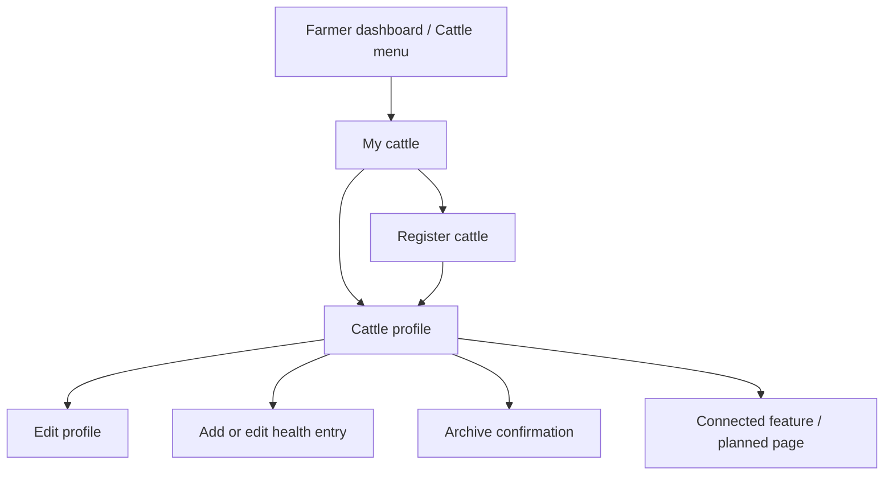
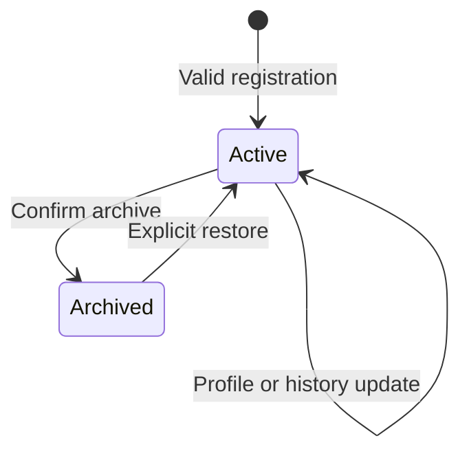
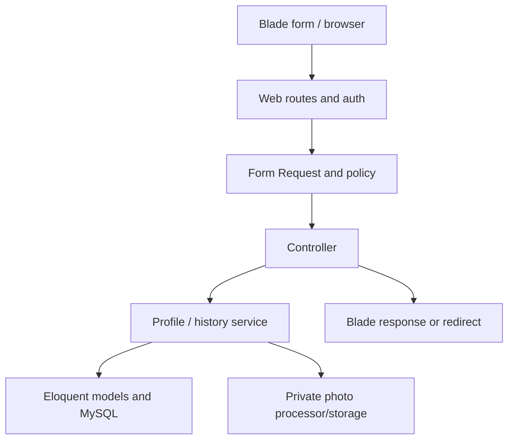
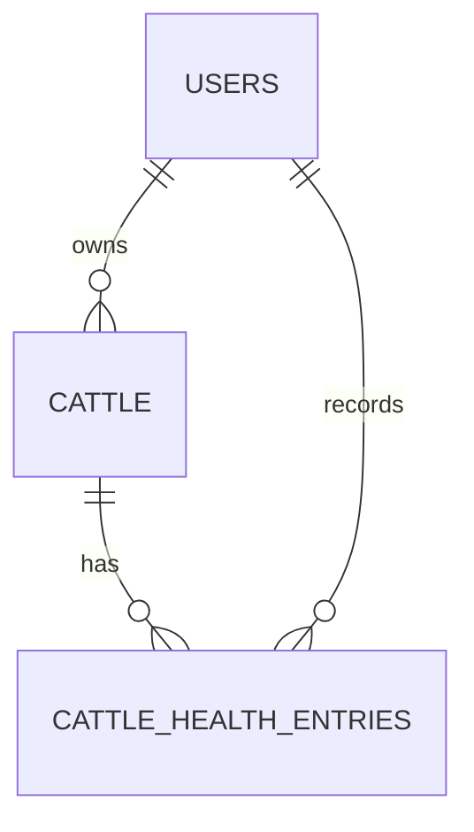

# F6 — Digital Cattle Profiles

**Krishi Bondhu · CSE470 · BRAC University · Group 8**  
**Owner:** Emon (`emon/`) · **Sprint:** 1 · **Version:** 1.0 · **Prepared:** 13 November 2026

## 1. Purpose, evidence, and handoff

This is the feature-level information architecture, UX specification, Laravel MVC implementation contract, database design, security checklist, demo-data plan, and acceptance-test plan for **F6 / R6: Digital Cattle Profiles**.

Recommended repository path: `docs/features/F6-digital-cattle-profiles.md`. If the file is kept under its downloaded name instead, tell the coding agent the actual path; do not maintain two competing copies. **The complete Claude implementation prompt is in §22.** The demo/testing instructions are in §19–20.

**Confirmed by the user:** F1 has been implemented; teammates are working and may have pushed changes; Emon now wants F6; teammates should run `php artisan migrate` after pulling staging. The user wants visible, complete frontend journeys, connected-feature placeholders, demo farmer accounts/data/images, and explicit instructions for testing.

**Documented baseline:** the previously supplied `project-context.md`, `architecture.md`, `design-system.md`, `IA.md`, `srs.md`, `workflow.md`, setup and disclosure documents, plus the F1 specification. These copies predate the latest implementation. They establish conventions but do not prove the current code, demo commands, credentials, or database schema.

**Proposed here:** screen details, field limits, age representation, archive behavior, health-history structure, demo fixtures, and new supporting routes. These are implementation defaults, not additional faculty requirements. The implementer must reconcile them with current staging, especially F1’s actual image/validation/demo code.

No source-code audit, application test, usability test, or benchmark has been performed for F6 in preparing this document. Research references are in §23. Review perspectives are product/UX and accessibility, Laravel/security, MySQL/data integrity, and independent full-stack verification; these are responsibilities, not claims that human experts tested the application.

**Product outcome:** a farmer can open “My cattle,” register an animal, recognize it by photo and stable ID, see its age/parent information and recorded health history, and update their own records with confidence.

## 2. Preserve the existing product and team workflow

| Area | Contract |
| --- | --- |
| Application | One Laravel 13 / PHP 8.4 MVC app, Blade, custom CSS, plain JavaScript, MySQL 8.4 LTS; verify the installed versions, do not upgrade for F6 |
| Authentication | Existing phone/password login, multi-role accounts, `Role::FARMER`, session auth; no second registration/login system |
| Frontend | Existing layout, UI components, fonts, semantic tokens, theme and language switches; inspect real component props |
| Existing feature | Preserve F1, marketplace navigation, upload behavior and existing demo farmers/crops |
| Routes | Keep existing `cattle.*` resource names and `/cattle` paths; use `routes/modules/cattle.php` |
| Language | Same URLs for English/Bangla; existing locale middleware and translation conventions |
| Infrastructure | No new API backend, CSS framework, npm/Vite pipeline, queue worker, Redis, or package merely to build F6 |
| Git | Follow current `AGENTS.md`, `CONTRIBUTING.md`, and `docs/workflow.md`; feature branch such as `emon/f6-digital-cattle-profiles`, PR to staging |
| Migrations | After pulling/merging staging, check the configured database and run `php artisan migrate`; update dependencies if the lockfile changed |
| Database safety | Never use `migrate:fresh`, `db:wipe`, truncation, or broad demo resets on the development/shared database |
| Tests | Existing `composer check`, real MySQL test database, F1/account/navigation regression checks |

Start by checking branch status and preserving unfinished work. If F1 has not reached staging, do not assume its helpers exist there or copy an entire feature branch blindly. Resolve that dependency using the project workflow. Only run migrations against the intended local development database; never against an unknown remote database.

Demo seeders are separate from migrations and must not run automatically for every teammate or release. Migrations change structure; they do not distribute someone else’s uploaded photos or local demo records.

## 3. Research applied to the feature

| Primary-source evidence | F6 design decision |
| --- | --- |
| WOAH describes animal identification with stable identifiers, associated records, error prevention and confidentiality [S1]. | Use an immutable application ID, validate record consistency and keep each farmer’s records private. This student app is not a national livestock registry or proof of ownership. |
| USDA’s cattle-identification reference includes identification, approximate age, sex and breed [S2]. | Support estimated age honestly instead of forcing a fabricated birthday; keep farm tags distinct from the app ID. This does not import US regulatory rules into Bangladesh. |
| W3C’s form guidance explains understandable errors and submission feedback [S3]. | Use grouped forms, labels, linked errors, retained text and clear success states. |
| Laravel documents policies, Form Requests and transactional locking [S4–S6]. | Put authorization, validation and coordinated writes in explicit MVC responsibilities. |
| OWASP emphasizes request-level authorization and layered upload defenses [S7–S8]. | Protect profiles, health entries, parent details and every photo read; sanitize uploads. |
| MySQL describes composite-index behavior [S9]. | Choose indexes for owner-scoped queries and health-history ordering, then measure. |
| Unsplash distinguishes its general image license from API-specific requirements [S10–S11]. | Prefer a curated set of permitted demo images with source credits; do not accidentally treat API images as unrestricted offline assets. |

The exact UX, age algorithm, schema and demo plan below are KB design proposals. No farmer interviews were conducted. Test terminology and ease of use with actual farmers if possible, or identify student testers as proxies.

## 4. Scope and boundaries

### 4.1 Required by F6

- Farmer registers cattle with a unique ID, photo, breed, age, parent details and health history.
- Farmer views and updates their own cattle records.
- A usable frontend exposes these capabilities through the existing website.

“Unknown” is a valid representation of unavailable age, breed or parent information. It must not be silently filled with invented data. An empty health history means **no history recorded**, not “healthy.”

### 4.2 Proposed supporting behavior

| Choice | Default |
| --- | --- |
| Workspace | Private “My cattle” grid/list and profile page |
| Unique identifier | Server-generated immutable ULID-based KB cattle ID, unique in the database |
| Farm tag/name | Optional farmer-entered tag and nickname, separate from identity |
| Profile photo | One required image on registration; replaceable; protected thumbnail/display variants |
| Age | Exact date of birth, estimated age with recorded date, or explicitly unknown |
| Parent details | Mother/father free-text reference details; unknown allowed; no automatic relationship inference |
| Health history | Dated or explicitly undated owner-recorded entries; optional initial entry, later add/edit |
| Archive | Optional supporting behavior using the existing destroy route; preserve records and make archived profiles read-only, with restore |
| Owner search | Small, scoped search by ID, farm tag, nickname; active/archive filter |
| Demo | Reusable local demo accounts, representative cattle, health notes, Unsplash cattle photos and safe cleanup |

Archive is useful because the global IA already reserves a destroy route, but F6’s SRS does not explicitly require permanent deletion. Do not invent a cattle-sale or ownership-transfer workflow.

### 4.3 Related features remain separate

| Feature | F6 boundary and connection |
| --- | --- |
| F1 crop marketplace | Keep it working; cattle profiles are private records, not products or a new cattle marketplace |
| F7 insemination records/agent sharing | Keep planned routes and contextual navigation; do not grant agent access merely because the role exists |
| F8 parent links/family tree | Store understandable parent details now; actual parent IDs, graph traversal and relationship editing belong to F8 unless already implemented |
| F9 breeding warnings | Show the planned entry point; no relatedness score or advice in F6 |
| F10 pregnancy/calving | Preserve route contracts; do not infer pregnancy from sex, age or notes |
| F17 health guidance | Link to the existing destination if working; no AI diagnosis in F6 |
| F18 veterinary search/requests | Link to the actual implemented vet flow if available; avoid inventing a `cattle_id` API parameter it does not accept |
| F19 treatment records | F6 stores basic historical notes; no medication recommendations, dose calculators, schedules, reminders or duplicate treatment engine |
| F24 | Reuse current language/theme and low-data hooks; do not promise autosave/offline recovery |

If a related feature already exists in staging, use its real behavior. Do not replace working pages with placeholders because an older document called them Planned.

## 5. Entry points, permissions, and privacy

**Where Emon will test:** sign in as a Farmer → header **Cattle** or dashboard **My cattle** → `/cattle`. Add cattle lives at `/cattle/create`. The final implementation handoff must print the actual local base URL and working links.

The dashboard should have a discoverable farmer card. Within the cattle workspace provide breadcrumbs and “Back to my cattle.” Keep the existing global header; no separate application shell.

| Actor | List/create | Read profile/photo/history | Update/archive/restore |
| --- | --- | --- | --- |
| Guest | Login redirect | No record/image data; normal protected-page login behavior | Denied |
| Signed-in non-farmer | 403 workspace restriction | No access through F6 | Denied |
| Farmer owner | Own records only | Own active and archived records | Active records; explicit restore on archived |
| Another farmer | Their own records | 404 for another farmer’s IDs, images and notes | Denied without disclosing private details |
| Vet/agent/admin without Farmer ownership | No automatic F6 access | Separate future/implemented policies govern any sharing | No implicit global bypass |

Check ownership on nested routes and photo responses as well as the main page. Knowing a KB ID or database ID is not authorization. Search results, counts and demo data must also be owner-scoped. A multi-role Farmer remains a valid owner.

## 6. Navigation and exact routes



### 6.1 Existing resource routes: retain names and paths

| Method | URI | Name | Action |
| --- | --- | --- | --- |
| GET | `/cattle` | `cattle.index` | Owner index |
| GET | `/cattle/create` | `cattle.create` | Registration form |
| POST | `/cattle` | `cattle.store` | Validated registration |
| GET | `/cattle/{cattle}` | `cattle.show` | Owner profile, history and connected features |
| GET | `/cattle/{cattle}/edit` | `cattle.edit` | Edit profile |
| PUT/PATCH | `/cattle/{cattle}` | `cattle.update` | Save profile or explicit restore operation |
| DELETE | `/cattle/{cattle}` | `cattle.destroy` | Confirmed archive, if this supporting behavior is adopted |

### 6.2 Proposed supporting routes

| Method | URI | Name | Purpose |
| --- | --- | --- | --- |
| GET | `/cattle/{cattle}/photo/{variant}` | `cattle.photo` | Owner-only `thumb` or `display`; no public file URL |
| GET | `/cattle/{cattle}/health-history/create` | `cattle.health-history.create` | New entry form |
| POST | `/cattle/{cattle}/health-history` | `cattle.health-history.store` | Create health-history entry |
| GET | `/cattle/{cattle}/health-history/{entry}/edit` | `cattle.health-history.edit` | Edit an entry belonging to this animal |
| PUT/PATCH | `/cattle/{cattle}/health-history/{entry}` | `cattle.health-history.update` | Validated entry correction |

These are five additions, not already-established routes. Reconcile actual routes before registering them, document them in `docs/IA.md`, and derive the total route count from the application. No separate public cattle-detail or JSON API is proposed.

Use `{cattle}` exactly as the existing parameter. The model can be `Cattle` with explicit `$table = 'cattle'` if necessary; verify Laravel’s pluralization/current conventions instead of accidentally creating `cattles` alongside another table. Default ID binding may remain numeric; show the human-facing KB ID independently. Do not change global binding to ULIDs without checking related routes.

Index query: `q` maximum 80 characters, `scope=active|archived|all`, `page`; 12 items per page. Default Active, newest updated first with ID tie-breaker. Profile history uses `health_page`, 10 entries per page, independently of the herd index.

Creation/photo replacement use `multipart/form-data` POST forms; use `_method=PATCH` for updates rather than relying on native multipart PUT parsing. Every mutation carries CSRF. Profile update uses an allowlisted `operation=save|restore`; restore accepts only its operation/version inputs and must not secretly edit other fields. Successful writes use Post/Redirect/Get. Validation failures use the existing Laravel web-form errors/old-input flow; stale versions receive a clear 409 response. GET search/filter inputs are validated and preserve their values in pagination links.

### 6.3 Connected features: visible, honest, accessible

Preserve the established named GET destinations:

| Link from profile | Route |
| --- | --- |
| Insemination records | `cattle.inseminations.index` |
| Family tree | `cattle.family-tree` |
| Pregnancy records | `cattle.pregnancies.index` |
| Breeding check | `breeding-check.create` |
| Find a veterinarian | `vets.index` |

For a working destination, link normally and preserve its own access rules. For a planned destination, keep the named route and show a clearly labelled **“Not implemented yet”** page with a useful return link. Add a small Planned label to the link. If the current product already has accessible toast support, clicking may also announce the message; the toast must not be the only explanation, and the link must remain usable without JS.

Do not use `href="#"`, permanently disabled controls without an explanation, fake successful POSTs, or a global change to every PlannedController route. Protect cattle-specific placeholder pages against other-owner access. Unimplemented mutation routes retain explicit unavailable behavior such as the current 501 contract; they never claim to save data. A route’s existence alone does not mean its feature is implemented.

## 7. Record lifecycle and domain rules



- Every record is private from creation; there is no Published state.
- An archived animal disappears from the default herd list but remains available to its owner through the Archived filter. Profile/history/photo are readable; editing and adding health entries are blocked until restore.
- Archive means “not in the active workspace,” not deceased, sold, transferred, or medically inactive. Do not infer an animal’s condition from this flag.
- Use `archived_at` rather than deleting rows. No permanent-delete route, ownership transfer or account reassignment is part of F6.
- KB ID never changes or gets reused after archive/restore. Farm tag may change with validation.
- Health-history notes are statements entered by the farmer. No notes does not mean no disease; old vaccination notes do not prove current immunity.
- F6 does not derive “Healthy”, “Sick”, “Pregnant”, “Ready for breeding” or compliance badges.

## 8. Screen-by-screen UX

### 8.1 My cattle

Order: Dashboard breadcrumb → H1 “My cattle” → primary Register cattle → compact active/archive navigation → labelled search → cards → pagination.

Card content: private thumbnail, nickname if present, farm tag if present, full KB ID (wrap, never ambiguously truncate), breed, sex, age with approximation label, archive status when relevant. Main link opens profile. An Edit link can be separate; do not nest interactive controls inside a linked card. Avoid showing sensitive health prose on every card.

Empty states distinguish no cattle, no search match, and no archived records. The no-cattle state has Register cattle; a search miss has Clear search. Do not show fake milk yields, revenue, breeding statistics or online/active-farmer indicators unrelated to this feature.

### 8.2 Register cattle

Use the existing narrow 720 px form shell and four sections. Each section has concise hints and visible required/optional labels; all sections remain functional without JS.

| Section | Information |
| --- | --- |
| Identity and photo | Photo; optional nickname; optional farm tag; sex; breed known/unknown and description |
| Age | Exact birth date / Estimated age / Unknown; show only relevant inputs with JS, explain ignored groups without JS |
| Parents | Optional mother details and father details; explain that actual family linking comes later |
| Health history | Optional initial history note, event type/date when known, source label; explain that more entries can be added later |

Explain: “A unique KB cattle ID will be created when you save.” No editable system-ID field. Primary **Register cattle**, secondary Cancel. The form is private; do not reuse F1’s public-publication copy.

The optional initial history entry prevents an all-or-nothing registration barrier. If the farmer does not know the history, leave it empty and show an honest empty state after creation. Never insert fake vaccination/treatment records to satisfy a required field.

After success, redirect to the profile with “Cattle registered” and the real KB ID. Provide Edit profile, Add health entry and Back to my cattle. An optional Copy ID button must have keyboard support and visible fallback text.

### 8.3 Cattle profile

Order: breadcrumb; success/archived alert; title with nickname or farm tag, otherwise “Cattle profile”; KB ID; primary Edit profile; photograph; identity/age details; parents; health history; connected feature links; archive controls.

Use a compact desktop split for photo and identity details, stacking on mobile. Do not make a giant dashboard hero. A definition list works well for profile attributes. Display full photo without cutting off identifying markings; thumbnails may crop in a stable viewport.

Parents section labels **Mother (dam)** and **Father (sire)** in understandable language, displaying entered details or “Not recorded.” Text like “Tag 22, neighbouring farm” is not a verified link. Never resolve it to another farmer’s record automatically.

History is a newest-known-event-first list: event date, type, title, farmer-entered note, optional source label, recorded/edited timestamp and Edit entry. Undated events form an explicitly “Date not recorded” group after dated entries. Paginate; do not load an unbounded lifetime history.

No-entry copy: “No health history recorded. This does not confirm the animal’s health.” Show Add health entry. The linked vet page may help a user seek a professional, but F6 should not generate diagnosis or treatment instructions.

### 8.4 Edit profile

Reuse the form partial, keeping the KB ID and owner immutable. Existing photo stays unless a valid replacement commits. Parent text edits must not accidentally delete a future F8 relationship.

Show the current age interpretation. Default **Keep current age information**. An explicit **Replace age information** choice opens the exact/estimated/unknown controls. A new estimate is recorded as of today; an unrelated nickname edit must not reset the old age estimate’s reference date.

If the new exact birth date is after existing dated health events, block the change with a clear consistency message and links to review those entries. If switching to an estimated/unknown age, do not fabricate a birth date or automatically rewrite historical events.

### 8.5 Add/edit health entry

Keep the cattle identity summary visible so the farmer knows which animal they are updating. Fields: type, title, date known/unknown, details, optional source label. Primary Save entry. No drug catalogs, medical dosing, attachments, or treatment-completion status in F6.

Editing is a correction to a farmer’s note. Display “Edited” and the last-edit date after a change. F6 does not promise an immutable clinical audit log or retain every previous text revision. There is no health-entry delete button in this scope; a mistaken note can be corrected clearly. If the product later needs certified medical records, design provenance and revision history with that feature.

### 8.6 Archive and restore

Owner profile link reloads `cattle.show` with `?confirm=archive#archive-confirmation`, rendering a dedicated confirmation region. Explain: “This animal will leave your active list. Its profile and history will remain available in Archived.” Final form uses DELETE, CSRF, `version`, and `confirm_archive=1`. GET never changes state.

Archived profile offers Restore, using PATCH with `operation=restore` and version. No “permanently deleted” success text. Show unavailable edit controls with explanatory text instead of silently allowing writes.

## 9. Field contract and age calculation

### 9.1 Profile fields

| Field | Proposed validation / meaning |
| --- | --- |
| `public_id` | Server-generated ULID, database unique, immutable; display `KB-C-` prefix outside stored value |
| `nickname` | Optional trimmed Unicode, ≤80 characters |
| `farm_tag` | Optional trimmed Unicode, ≤50 characters, normalized consistently; unique per farmer including archived cattle; null rather than empty string |
| `sex` | Required allowlist `female`, `male`, `unknown`; no automatic maturity/breeding assumptions |
| `breed_known` | UI choice known/unknown; a known breed requires `breed_description` |
| `breed_description` | Nullable plain text, 2–100 characters when provided; farmer-described, not verified; use existing shared breed vocabulary only if already agreed |
| `age_basis` | `exact`, `estimated`, `unknown` |
| `birth_date` | Exact mode only; valid DATE ≤ today in Asia/Dhaka |
| `estimate_years`, `estimate_months` | Estimated mode only; integer years 0–50, month part 0–11; total months ≤600 |
| `estimated_age_months` | Server-normalized integer; 0 means “less than one month” estimate |
| `age_recorded_on` | Server-assigned Asia/Dhaka calendar date when an estimate is made; never accepted as a freely editable timestamp |
| `age_update` | Edit only: `keep` or `replace`; controls whether the entire age representation is replaced |
| `mother_details`, `father_details` | Optional plain text ≤300 characters each; unknown is represented by null, not a fictitious record |
| `photo` | Required on create, optional replacement on update; one accepted JPEG/PNG, limits in §14 |
| `version` | Required positive integer for existing-record mutations |
| `submission_token` | Create UUID, used for duplicate submission protection |

The 50-year input ceiling is a permissive data-entry guard, not a claim about cattle lifespan. Do not reject records with invented biological rules. Newborn exact dates are valid. Unknown age is preferable to a fabricated date.

Only the selected age mode’s fields may be populated in storage:

| Mode | Stored values | User-facing age |
| --- | --- | --- |
| Exact | `birth_date`; estimate fields null | Completed calendar years/months; days for under one month; “Born today” for zero days |
| Estimated | `estimated_age_months` + `age_recorded_on`; birth date null | “About …”; show original estimate/reference date on detail |
| Unknown | All age-value/date fields null | “Age not recorded” |

For estimates, present-day approximate age = recorded total months + completed calendar months since `age_recorded_on`. Use a tested calendar-month helper with month-end clamping: 31 January → 28/29 February counts as one month. Never divide seconds by 30 days. Exact age uses calendar anniversaries with an explicitly tested leap-day/month-end convention. Freeze the clock in tests.

Use a single Asia/Dhaka “today” value per request for calendar operations; timestamps remain UTC. Do not persist a constantly changing current-age number, age string or invented estimated birthday. Update reference date only when `age_update=replace` selects estimated mode. Preserve age fields on `keep`, ignoring/rejecting unrelated supplied age changes consistently.

### 9.2 Health-entry fields

| Field | Proposed rule |
| --- | --- |
| `entry_type` | `observation`, `vaccination`, `vet_visit`, `treatment_history`, `other`; historical recording only |
| `title` | Required 3–120 characters |
| `occurred_on` | Required when date-known is selected; valid date ≤ today; null when explicitly unknown |
| `details` | Required 5–2,000 plain-text characters |
| `source_label` | Optional ≤120 characters, e.g. “Farmer’s notebook”; unverified attribution, not a real vet account link |
| `version` | Required on entry update; separate from the profile version |
| `submission_token` | Required UUID for initial standalone entry creation; scoped to the cattle record |

A known event date cannot precede an exact birth date. With unknown/estimated age, do not enforce a fabricated birth-date lower bound. Future appointments and reminders are not historical entries. Do not default an unknown event date to today; `created_at` separately records when it was entered.

Normalize Bangla digits for numeric inputs, trim text, reject malformed dates/integers, escape all output and use clear translated error labels. User-written breed/parent/history text remains in its original language. The KB ID remains canonical ASCII for copy/search even on Bangla pages; numeric age displays can localize.

## 10. Design system and accessibility

- Use `<x-layouts.app>`, existing page-header, media-card/card, field/select/textarea/checkbox, badge, alert, empty-state, button, list-row, and cow-head icons where their real APIs support it.
- Follow existing 1180 px content and 720 px form widths, 48 px controls, ≥44 px targets, typography and spacing tokens. Do not introduce a new cattle theme; small `earth` accents fit the existing system.
- Reuse the F1 card/form/error behavior that actually exists after reviewing it. Do not force cattle data into crop-specific component props or broaden F1’s authorization.
- Every page must work in English/Bangla and light/dark themes. Preserve existing fonts and Lipighor attribution. Long Bangla labels, tags and IDs wrap.
- Link summary errors to fields, provide inline hints and `aria-describedby`, visible keyboard focus, status text beyond color, and a predictable heading order.
- Use normal GET filters and native server forms. JS may preview a photo, switch visible age inputs, copy an ID or announce feedback. It is not required to register, edit, search, archive or add history.
- Avoid auto-playing motion, inaccessible custom date pickers, drag-only controls and empty decorative charts. Keep photo dimensions stable and lazy-load below the fold.
- A saved-message toast, if reused, supplements a persistent flash/inline message. Planned-feature feedback also needs a no-JS destination.

| Copy | English | Bangla draft for team review |
| --- | --- | --- |
| Workspace | My cattle | আমার গবাদিপশু |
| Register | Register cattle | গরুর তথ্য যোগ করুন |
| Approximation | Estimated age | আনুমানিক বয়স |
| Unknown | Not recorded | তথ্য দেওয়া হয়নি |
| Parent | Mother / Father | মা / বাবা |
| History | Health history | স্বাস্থ্যের ইতিহাস |
| Planned | This feature is not implemented yet. | এই সুবিধাটি এখনো চালু হয়নি। |
| Archive explanation | Kept in Archived; records are preserved. | আর্কাইভে রাখা হবে; তথ্য সংরক্ষিত থাকবে। |

The SRS feature is cattle; do not silently expand to goats, poultry or a generic multi-species system because the Bangla navigation label can be broader. Review terminology with a fluent Bangla speaker and target users.

## 11. Laravel MVC responsibilities



| Responsibility | Proposed location |
| --- | --- |
| Profile resource actions | `app/Http/Controllers/CattleController.php` |
| History form/write actions | `app/Http/Controllers/CattleHealthEntryController.php` |
| Authorized image response | `app/Http/Controllers/CattlePhotoController.php` |
| Request validation | `StoreCattleRequest`, `UpdateCattleRequest`, `ArchiveCattleRequest`, `StoreCattleHealthEntryRequest`, `UpdateCattleHealthEntryRequest` in `app/Http/Requests/` |
| Ownership/access | `CattlePolicy`, plus history policy or consistently scoped parent-policy checks |
| Data | `Cattle`, `CattleHealthEntry` in `app/Models/` |
| Transactions/business rules | `CattleService`, `CattleHealthHistoryService` in `app/Services/` |
| Age interpretation | Small tested `CattleAge` helper/value object; follow current repo organization |
| Photos | Reuse a safe existing low-level processor where appropriate; F6 owns private access rules and paths |
| Views | `resources/views/cattle/` with index/create/show/edit and shared form/profile/history partials |
| History views | `resources/views/cattle/health-history/` create/edit and form partial |
| Assets | Page-scoped `public/js/cattle.js`, optional cattle CSS using existing tokens |
| Data/setup | Additive migrations, factories, explicit demo command/seeder |
| Tests | `tests/Feature/Cattle/` and focused age/validation unit tests |

These are proposed names, not authority to overwrite teammates’ classes. Check the live tree. Keep queries out of Blade and ownership checks on the server. Do not add generic repositories, a clinical-record platform, or a public cattle API. Extract a shared image processor from F1 only if the current code makes that safe and the team agrees the shared change; reuse does not justify coupling cattle privacy to crop-publication rules.

## 12. Database schema

**Proposed minimum: two feature tables**, using existing `users` and roles. A single profile photo does not need a generic attachment table unless the repository already has a suitable one.



### 12.1 `cattle`

| Column | Type / constraint | Meaning |
| --- | --- | --- |
| `id` | Unsigned BIGINT PK | Internal identity for relationships |
| `public_id` | CHAR(26), unique, non-null, canonical ULID | Stable KB identity; `KB-C-` is display prefix |
| `farmer_id` | Unsigned BIGINT FK to users, non-null, restrict hard deletion | Owner from authenticated user |
| `nickname` | VARCHAR(80), nullable | Optional familiar name |
| `farm_tag` | VARCHAR(50), nullable | Owner-local identifier |
| `sex` | VARCHAR(10), non-null | Female/male/unknown code |
| `breed_description` | VARCHAR(100), nullable | Farmer-described breed; null = unknown/not recorded |
| `age_basis` | VARCHAR(12), non-null | Exact/estimated/unknown |
| `birth_date` | DATE, nullable | Exact mode only |
| `estimated_age_months` | Unsigned SMALLINT, nullable | Recorded estimate, not changing current age |
| `age_recorded_on` | DATE, nullable | Estimate reference date |
| `mother_details`, `father_details` | VARCHAR(300), nullable | Parent descriptions; no inferred foreign keys |
| `photo_path`, `photo_thumbnail_path` | VARCHAR(255), non-null | Server-generated private relative paths |
| `photo_width`, `photo_height` | Unsigned SMALLINT, non-null | Display variant dimensions |
| `version` | Unsigned INT, non-null, default 1 | Profile concurrency version |
| `submission_token` | CHAR(36), non-null | Registration deduplication key |
| `archived_at` | Nullable timestamp/datetime | Workspace archive state, not death/ownership status |
| `created_at`, `updated_at` | Repo timestamp convention, UTC | Actual entry/update timestamps |

Constraints:

- Unique `(farmer_id, farm_tag)` including archived cattle; multiple null tags allowed. Define matching case/normalization behavior consistently between validation and MySQL. An archived tag conflict links the owner to their existing animal; no automatic tag reassignment.
- Unique `(farmer_id, submission_token)` and unique `public_id` are different guarantees: one prevents retry duplicates, the other prevents identity collisions.
- CHECK allowed sex/age modes, `version >= 1`, estimate 0–600, and mutually exclusive age fields. Write CHECK expressions with explicit `IS NULL`/`IS NOT NULL` branches: SQL UNKNOWN must not allow an invalid age combination through.
- Date-versus-today and cross-table history/date consistency stay in application services. Do not use a time-dependent CHECK.
- No stored current age, `is_healthy`, pregnancy status, copied owner phone/name, duplicate full-photo BLOB, or public flag.

### 12.2 `cattle_health_entries`

| Column | Type / constraint | Meaning |
| --- | --- | --- |
| `id` | Unsigned BIGINT PK | Entry identity |
| `cattle_id` | FK to cattle, non-null, restrict hard deletion | Parent animal |
| `recorded_by` | FK to users, non-null, restrict hard deletion | Original author, set server-side |
| `entry_type` | VARCHAR(24), non-null, code CHECK | Observation/vaccination/vet visit/treatment history/other |
| `title` | VARCHAR(120), non-null | Short event label |
| `occurred_on` | DATE, nullable | Actual known event date; null means undated |
| `details` | TEXT, non-null; application max 2,000 characters | Farmer’s history note |
| `source_label` | VARCHAR(120), nullable | Optional unverified source description |
| `version` | Unsigned INT, default 1 | Entry concurrency version |
| `submission_token` | CHAR(36), non-null | Entry-create retry protection |
| `created_at`, `updated_at` | UTC timestamps | Recorded/edited time, distinct from event date |

Unique `(cattle_id, submission_token)`. `recorded_by` preserves authorship even if future access rules expand; it is not a second editable ownership field. F6 does not transfer cattle or author identity. No soft-delete column is needed because entry deletion is out of scope.

Do not duplicate notes as a JSON array on the parent, create one table per note type, or store vaccination/treatment facts a second time if an existing F19 schema already owns them. In that case, reconcile the history UI and source-of-truth contract before implementing this proposed table.

### 12.3 Parentage boundary

Basic parent descriptions satisfy the F6 record requirement without building F8. Do not pre-create a lineage graph or guess parent identities from tags/names. F8 can later add explicit mother/father references with its own same-animal, sex, ownership/share, cycle, chronology and ancestry rules.

If parent foreign keys already exist, use their established contract and show linked parent facts as linked data. Distinguish external free-text references from linked parents; do not keep two contradictory authoritative values for the same fact. A farmer must never browse all users’ cattle to choose a parent.

## 13. Write operations, retries and concurrency

### Registration

1. Authenticate, authorize Farmer, apply write limits and CSRF; normalize/validate a complete Form Request.
2. Look for an existing record under this farmer and submission token. A valid replay returns that record without altering it. Archived replays remain archived, never resurrected.
3. Validate/process one photo into new private paths before the database transaction. Keep the attempt’s exact paths for compensation.
4. In one transaction create cattle with server owner/ULID/version, optional initial history entry, and the image metadata. Generate any initial-entry token server-side. Do not use `max(id)+1` or trust user-supplied public IDs.
5. On farmer/token uniqueness race, roll back the losing attempt, delete its files and return the winning record. On tag collision, give a field error. On a true ULID collision, retry generation a bounded number of times. Distinguish constraints; unrelated DB failures are not successful retries.
6. After commit redirect to the owner profile. On failure remove newly prepared files; a reconciliation command handles leftovers from crashes.

`submission_token` is not an auth credential. Generate a UUID per new form, preserve it on validation errors, and validate ownership normally. Disabling a button and Post/Redirect/Get help UX but do not alone prevent duplicate records. Valid repeated requests must preserve the same token.

### Profile update and photo replacement

Authorize before expensive processing. Validate; prepare a replacement photo if provided. In a short transaction lock the parent row, verify owner/active state and submitted `version`, apply the selected age operation, and verify any exact birth-date change against all dated history. Save allowlisted fields, increment version exactly once, commit. Only then delete the old photo variants.

Stale edits return a readable 409 with submitted text and a link to the latest form; do not silently overwrite. New files from the losing attempt are removed. A failure to delete an old file after a successful commit is a cleanup warning, not a failed update. Do not place filesystem side effects inside retried transaction closures.

### Health-entry writes

Always scope `{entry}` to `{cattle}` and authorize that parent. Lock the cattle row first, then the entry on update. Confirm the animal is active, validate date against the current exact birth date, and compare the entry’s own version. A competing profile birthday edit uses the same parent-first lock, so the two operations cannot create contradictory history dates.

For create, the unique `(cattle_id, submission_token)` handles duplicate requests. On update, keep original author, increment entry version and mark edited through timestamps/version. A history change does not need to increment the profile version; these protect separate editable records. If the herd list should reflect history activity, design that explicitly rather than silently redefining `updated_at` as “last health event.”

### Archive and restore

Both authenticate/authorize, lock the parent, compare profile version and change `archived_at`, incrementing version. Archive additionally requires explicit confirmation. All history writers check active state under the same lock, preventing writes after an archive commits. Restoration reuses the original identity and records; it does not copy or re-register the animal.

If F7/F10/F19 services already write to cattle-related records, reconcile their lock order and archive behavior. Do not assume an F6-only check protects writes in another controller.

## 14. Private photo pipeline

Inspect F1’s actual implementation before reusing any code. Shared decoding/storage primitives may be reusable; **a cattle image never becomes public because a crop image can be public.**

Proposed limits: one JPEG/PNG, ≤5 MiB, ≤6,000 pixels on either axis and ≤12 million pixels total. Reject SVG/GIF/HEIC, remote-image URLs and malformed inputs with clear guidance. Validate content and successful decoding, not just filename/extension or browser `accept`.

Correct camera orientation, strip metadata/GPS, flatten transparency appropriately, and re-encode a ≤1,600 px display variant plus ≤480 px thumbnail. Never serve the original upload. Verify existing image-library/PHP-extension support in local, CI and hosting environments. Keep resource limits and fail cleanly; do not add a new media package as a shortcut without required project approval.

Use generated private paths in an F6-owned directory, outside any public storage link. Serve only fixed variants through the authorized route, with the correct MIME, `nosniff`, and private no-store caching for this first version. No user-controlled filesystem paths or arbitrary remote fetching. Thumbnail URLs are private too.

Create/update must never point at partially written files. Failed processing/database writes remove only this attempt’s files; old files are deleted after successful replacement. If a stored image is missing, show a tinted cow-icon placeholder and owner repair guidance rather than a fatal page or a fabricated stock image.

Reuse or add an F6-scoped orphan reconciliation command: dry-run first, consider files older than 24 hours, check against all cattle references including archived records, and touch only the F6 directory. Do not run F1 cleanup against F6 storage. Hosted storage must be persistent and backed up; local photos do not travel with Git migrations.

## 15. Queries and performance

| Access pattern | Initial index / strategy |
| --- | --- |
| Owner active/archive list | `(farmer_id, archived_at, updated_at, id)` |
| Human ID lookup | Unique `public_id`, plus owner check |
| Farm tag lookup | Unique `(farmer_id, farm_tag)` |
| Retry lookup | Unique `(farmer_id, submission_token)` |
| Health timeline | `(cattle_id, occurred_on, id)` ordered descending; MySQL puts null dates after known dates in this descending order |
| Health retry | Unique `(cattle_id, submission_token)` |

Archive-range and All filters may still require sorting; inspect `EXPLAIN` before adding a second list index. Do not claim every filter combination is index-covered. Avoid redundant FK indexes where an existing composite prefix already satisfies the requirement, without dropping a required index blindly.

Search contract: scoped exact KB ID/tag lookup first; otherwise a bounded literal prefix search on nickname/tag within the owner’s herd. Escape SQL LIKE `%` and `_` as data, use bound values, and group all OR predicates inside the owner scope. Otherwise a search OR can leak another farmer’s record. Full-text search, all-farm global search and arbitrary sort columns are unnecessary.

Paginate SQL results (12 cattle / 10 health entries), never load all and paginate in PHP. Cattle cards use scalar profile fields; do not load every animal’s health history just to render a grid. If showing counts, use aggregate queries without N+1 calls. No database queries in Blade.

Proposed performance checks: bounded query counts as cards grow from 1 to 12; inspect plans on synthetic 10,000-cattle/50,000-history data in a dedicated test database; record actual hardware and timings. Aim for warm non-upload page requests below 500 ms p95 on the documented local baseline, not as a production promise. Load only thumbnails on the grid and keep display photos out of hidden preloads. No Redis or queued image infrastructure is required for this sprint.

## 16. Security and failure behavior

| Risk | Control / expected behavior |
| --- | --- |
| Other farmer’s ID, nested-entry ID or photo URL | Owner policy plus parent scoping on every request; no leaked content or existence detail |
| Forged `farmer_id`, KB ID, author, version increments or archive fields | Explicit request mapping; identity/system attributes set by server |
| Search OR escapes owner condition | Group predicates under mandatory owner filter; attack test with another owner’s nickname |
| CSRF or mutation by GET | Existing web middleware and CSRF; POST method spoofing for PATCH/DELETE; GET has no side effect |
| Stored XSS in notes/name/parent text | Escaped Blade and safe JS text insertion; no raw user HTML |
| SQL/path injection | Parameter binding, allowlisted filters/operations/variants; generated paths only |
| Malicious images / storage exhaustion | Bounded private processing, write throttles, capacity monitoring; no uncontrolled network imports |
| Duplicate register/add-history request | Scoped token uniqueness plus deterministic replay response |
| Two tabs overwrite changes | Separate profile/entry versions and transactional comparison; 409 on stale input |
| Archive races with history creation | Parent-first locking and active-state checks in every writer |
| Birth date changed past an existing event | Validate under same parent lock used by history operations |
| Wrong age/date | Mutually exclusive age representation; server reference date; no automatic history-date invention |
| Leaking health notes or credentials in logs | Log operation/IDs/correlation and errors minimally; not full requests, passwords or private narrative |
| Demo data accidentally active in production | Explicit environment guard, no automatic production seeding, no public demo-login bypass |

Suggested initial account write limits: 10 registrations/minute, 30 other writes/minute, applied before processing; tune based on measured use and reuse existing limiter conventions. These do not replace host storage limits or authorization.

On validation failure retain text and selected choices, link errors, and explain that new files must be selected again after server redirects. On timeout/connection uncertainty tell the user to check My cattle before starting another registration; a valid same-token retry returns the existing record. Session expiry, request-too-large and storage errors must not report successful saving or guaranteed recovery. Exact offline recovery remains F24.

## 17. Automated acceptance and adversarial tests

Run on the real designated MySQL test database. Fake storage for normal write tests, plus real temporary-image tests for decoding/orientation/metadata. Freeze time for age and midnight tests. None of these tests are claimed to have run yet.

| ID | Case | Expected evidence |
| --- | --- | --- |
| F6-T01 | Register complete cattle with photo and initial note | Correct owner, unique KB ID, profile and note committed together |
| F6-T02 | Missing photo, invalid sex/breed choice, excessive text, invalid age combination | Field errors; no partial record/files |
| F6-T03 | Exact newborn, leap day, month end, Dhaka midnight, future birthday | Calendar-correct result and future-date rejection |
| F6-T04 | Estimated age, zero months, future reference tampering, elapsed months | Approximation explicit; server anchor used; no fabricated DOB |
| F6-T05 | Unrelated edit with age keep; deliberate age replacement | Original estimate anchor preserved unless explicitly replaced |
| F6-T06 | Unknown age/breed/parents/history | Honest unknown/empty states, no healthy or verified badge |
| F6-T07 | Duplicate farm tag same owner, different owner, archived record, null tags | Intended scope and uniqueness, clear conflict recovery |
| F6-T08 | Duplicate registration token including concurrent requests | One cattle record and one child set; losing files cleaned |
| F6-T09 | Guest/non-farmer/multi-role Farmer | Correct access without breaking current auth |
| F6-T10 | Other owner attacks every profile/photo/history/archive route | No private content or mutation |
| F6-T11 | Entry B’s ID nested under cattle A | Rejected even when both cattle have the same owner |
| F6-T12 | Forged owner/public ID/author/archive/system fields | Cannot change authoritative values |
| F6-T13 | Notes/name/parent stored XSS and crafted search | Harmless escaped output; no other-owner search results |
| F6-T14 | Known, unknown, future and before-birth health dates | Correct validation; recorded timestamp distinct from event date |
| F6-T15 | Two stale profile edits and two stale entry edits | 409, first edit preserved; submitted text available for review |
| F6-T16 | Concurrent exact-DOB correction and entry create/update | No impossible date combination under shared parent lock |
| F6-T17 | Duplicate health-entry create and valid correction | One entry; version/edited state correct; author preserved |
| F6-T18 | Archive, read archived, write archived, restore | Records retained; read allowed to owner; writes blocked until restore |
| F6-T19 | Archive race versus health-entry creation | Consistent outcome, no post-archive write bypass |
| F6-T20 | Photo replacement plus file/DB failure | Old valid photo preserved or new commit completed; no half-save |
| F6-T21 | Malformed/mismatched/oversized/rotated/metadata-bearing images | Safe rejection or sanitized result; private paths only |
| F6-T22 | No JS; locale/theme; long Bangla text; pagination/search | Core actions work and consistent layouts render |
| F6-T23 | Planned connected feature versus implemented feature | Useful unavailable GET page or actual working flow; no fake success |
| F6-T24 | CSRF and rate limiting with middleware active | Forged write rejected; limit stops processing |
| F6-T25 | Demo seed twice | No duplicated accounts/cattle/entries; manual edits not overwritten |
| F6-T26 | Demo cleanup dry-run/apply | Only recorded fixture-owned objects removed; F1 and manual records preserved |
| F6-T27 | Demo guard in production and normal migrations | No seed/accounts/fixture download; no login backdoor |
| F6-T28 | Owner query count, history paging, LIKE metacharacters | Bounded work, correct owner/date ordering |
| F6-T29 | F1, login/registration, locale, dashboard, route-map suite | Existing functionality still passes |
| F6-T30 | Orphan cleanup with archived/reference/recent/unrelated files | Only eligible old unreferenced F6 files selected |

Sequential stale-version tests do not prove concurrency. Use separate connections/processes and deterministic synchronization for actual race tests. Ensure transactions really commit when testing after-commit cleanup. Laravel test environments may bypass CSRF, so enable/verify it for that test rather than claiming protection from a bypassed middleware test.

## 18. Manual UX review and AI-code evaluation

Test register → profile → edit → health entry → archive/restore on 320/360/390 px and desktop, English/Bangla, light/dark, keyboard-only, 200% text zoom, slow network and no-JS. Include long names/tags, unknown-age animals, undated notes, missing stored-photo recovery, and empty results. Use a screen reader when available.

Give 3–5 representative users/proxies tasks without coaching: find their herd, register one animal, explain whether the age is exact, add a past health note, identify the other feature’s Planned state, and locate an archived animal. Record assistance and misunderstandings, especially ID-versus-tag and “no history” versus healthy. Do not invent usability results or generalize a small sample statistically.

Review AI-generated code independently of its generated tests. Block merging for missing ownership scopes, guessed component APIs, public private-photo paths, user-controlled identity, fake DOB conversion, inappropriate medical status inference, lost-update races, overwritten teammate work, destructive demo cleanup, or tests weakened just to pass.

Emon should be able to explain the create-request flow, schema/constraints, how estimated age stays meaningful over time, authorization of nested health entries, why no parent graph is implemented yet, transaction/file compensation, and safe demo removal. Log real AI assistance and review status in `docs/ai-usage.md`; do not mark code understood before reviewing it.

## 19. Demo farmers, cattle and photographs — part of this implementation

The user explicitly wants an enriched first-run demo, not an empty feature followed by “create everything yourself.” Provide demo data **in addition to**, not instead of, a manual registration/upload test.

### 19.1 Reuse F1 safely

Inspect actual F1 demo seeders/commands, fixture ownership markers, assets and credential instructions first. F1 implementation is confirmed; the exact demo implementation is not. Reuse farmer accounts only when their demo provenance is explicit. Do not identify a demo user merely by a familiar name, phone prefix or email domain.

Prefer the same proven demo farmers for both crop listings and cattle so Emon can sign in once and explore both workspaces. Do not create duplicate accounts, reset existing demo passwords unexpectedly, delete crop listings, or overwrite records the team edited. If existing accounts cannot be verified as demo, create separately tracked local demo accounts with non-colliding login values.

### 19.2 Proposed fixture set

| Demo account | Cattle | Purpose |
| --- | --- | --- |
| Demo Farmer A | 6 total: 5 active, 1 archived | Populated dashboard/grid; English/Bangla names; exact and estimated age; varied history |
| Demo Farmer B | 4 active | Another populated herd and cross-owner privacy tests |
| Demo Farmer C | 2 active | Unknown age/breed/parents; no-history state; long wrapping text |
| Demo Farmer D | 0 | Empty-state and first manual registration test |

Total: **12 cattle**, 11 active and 1 archived. Labels above are fixture roles, not claims about accounts that already exist. Use clearly fictional display names, no stock people portraits. This is not a new public farmer-profile feature.

Suggested individual scenarios:

| Fixture | Scenario |
| --- | --- |
| A-01 | Adult female, exact birthday, farm tag, two dated history entries |
| A-02 | Male, estimated age, external father reference, one undated note |
| A-03 | Calf with exact recent birth date, no health history |
| A-04 | Bangla nickname/parent descriptions, history recorded in Bangla |
| A-05 | No nickname, valid farm tag; mixed/unknown breed description handled honestly |
| A-06 | Archived profile with preserved history/photo |
| B-01 | Same farm tag as A-01 under a different owner to prove per-owner uniqueness |
| B-02 | Several dated notes entered out of chronological order |
| B-03 | Estimated age under one month; explicit approximation |
| B-04 | Long nickname and parent reference for wrapping checks |
| C-01 | Unknown age, breed and parents; honest empty history |
| C-02 | Unknown sex, known age, one general historical note |

All 12 use valid sanitized cattle photos. Aim for approximately 12–18 history entries total, including unknown dates and no-entry animals. Keep notes clearly fictional and descriptive, e.g. “Demo: routine visit recorded in the farmer’s notebook.” Do not include real diagnoses, medication doses, fake veterinarian endorsements or assertions that image subjects match the fictional health/breed data.

Use valid initial dates relative to a stored fixture-run reference date. On rerun reuse that reference date and fixture IDs; do not shift birthdays or history each time the seeder executes. Edge-case corruption and broken photos belong in automated tests, not the normal demo that should look complete.

### 19.3 Unsplash cattle images

Use real **cattle** photographs from the ordinary free Unsplash collection for demo fixtures, as requested. This is an explicit demo-only exception to the normal rule that a real cattle record uses its owner’s actual photo or a neutral missing-photo placeholder.

Preferred approach: select a small curated set through normal permitted download use, verify each image/source/license, and prepare local fixture assets outside public uploads. Feed them through the same sanitizer as user uploads. Record source photo page, photographer, applicable license and access date in `docs/demo-assets.md`; credit photographers in the demo experience where practical. Do not guess image URLs, scrape the site, use Unsplash+ assets without the appropriate rights, or assume a photograph proves an animal’s breed.

If the implementer uses the **Unsplash API**, follow its separate hotlinking, attribution and download-event rules [S11]; do not silently download API results into an offline fixture library contrary to those rules. For this small private demo, a reviewed set of ordinary permitted local downloads avoids introducing an API dependency.

No Unsplash call or random-photo endpoint belongs in cattle registration, page rendering, production logic, automated tests or normal migrations. Once assets are prepared, demo seeding should work offline. Prefer unique images per animal where feasible; mark all demo identities/history as illustrative. If any image cannot be obtained, report the missing asset explicitly instead of claiming the photo/demo check passed.

Track fixture-source files and resulting private upload paths separately. The user’s real uploads must never be replaced with stock images. Whether small licensed source fixtures are committed is a team decision; generated uploads stay gitignored, consistent with the existing workflow.

### 19.4 Seeder/command contract

Reuse established demo command names if available. Otherwise proposed commands to implement are:

```bash
php artisan kb:demo-cattle seed
php artisan kb:demo-cattle credentials
php artisan kb:demo-cattle cleanup --dry-run
php artisan kb:demo-cattle cleanup --apply
```

**These commands are proposed, not currently verified to exist.** The final handoff must state the actual commands implemented. The command should:

1. Require an explicit local/testing environment and an opt-in demo configuration flag; fail closed in production. `--force` must not bypass this guard. Shared staging needs a deliberate team environment decision, not an automatic exception.
2. Refuse to use an unexpected database; migrations must already be applied. Do not run destructive schema resets to prepare fixtures.
3. Use stable fixture identities and explicit provenance. Prefer the current demo registry if it exists; otherwise keep a private, gitignored fixture manifest containing the generated IDs, run reference date, created/reused account IDs, paths, and baseline record fingerprints. Do not create redundant clinical columns just to support demos.
4. Record/reserve intended fixture IDs before writing and update the manifest atomically, so an interrupted run can reconcile its own rows without guessing from a name prefix. Transactional DB writes plus exact file compensation still apply.
5. Be idempotent: reruns create missing fixtures but do not overwrite edited animals, re-register identical cattle, regenerate passwords, add duplicate notes, or silently recreate intentionally removed test data. Report changes/skips and recovery needs.
6. Generate unique valid-format local phone-login fixture values after checking collisions; these are not guaranteed reserved/unassigned real-world phone numbers. Disable outbound SMS/email/calls for the fixture flow. No actual person should be contacted.
7. Generate local demo-only passwords, hash through existing account code, and expose credentials only in terminal/private gitignored instructions. Never commit real credentials or add a public auto-login shortcut. For reused accounts, use the existing known credential workflow rather than claiming to recover a password hash.
8. Print account labels, actual login phone numbers, cattle counts, local login/workspace URLs, and where credentials are available. Verify login through the normal form, with the Farmer role actually assigned.
9. Display an unobtrusive demo-account/fixture notice in development. Keep it out of real user records and production pages.

### 19.5 Safe removal and release

Cleanup must begin with a dry-run showing exact fixture records and paths. Delete only items proven to belong to this F6 run. Detect edited fixture records, new notes added during manual testing, or references from F7/F10/F19 and stop/skip them for review rather than cascading away someone’s work. Cleanup must not infer safety from “Demo” in a display name.

Default cleanup leaves reused F1 users, crops, roles, shared source assets and unrelated records untouched. Remove newly created F6-only accounts only if the manifest proves ownership and there are no remaining non-fixture references. Delete generated files only when no remaining record references them. A deliberate purge of archived demo cattle is a local fixture-maintenance operation, not a production force-delete feature.

Do not run `migrate:fresh --seed`, broad table truncation, or delete all Farmer accounts. Before a production release use a clean intended production database with normal migrations and demo mode disabled; if demo records were placed in another deployment, use reviewed scoped cleanup there. Demo credentials must not survive in a public production account.

## 20. “How do I test it?” — required handoff and walkthrough

Claude must finish with a concrete **Start here** guide. “Feature implemented” without URLs, credentials/demo instructions and manual test results is incomplete for this task.

### 20.1 Environment and demo startup

After following the repository’s branch/pull/merge workflow and confirming the local database:

```bash
composer install
php artisan migrate
composer check
```

Then run the actual F6 demo command (proposed `php artisan kb:demo-cattle seed`) with demo mode enabled locally, and start the app with the repository’s current command, normally `composer dev`. Do not assume it is at a particular port if another process or configuration changed it.

Provide a table with **actual verified values** after implementation:

| Item | Required handoff value |
| --- | --- |
| Base URL | Running local URL/port, not a guessed production domain |
| Login | `route('login')` URL |
| My cattle | `route('cattle.index')` URL |
| Add cattle | `route('cattle.create')` URL |
| Example populated profile | A real seeded record’s named-route URL and KB ID |
| Demo accounts | Actual phone logins; demo-only passwords or exact private credential-file path |
| Empty account | Which actual account has no cattle |
| Existing marketplace | Current working marketplace route, to regression-test F1 |
| Seed/cleanup | Actual command names and where source-image credits/manifest live |

This IA contains no working credentials because it has not created accounts. Do not present a proposed password or example ID as something that exists in the user’s database.

### 20.2 Demo walkthrough

1. Sign in as Demo Farmer A through normal phone/password login. Open Cattle from the header and dashboard; both should reach the same owner workspace.
2. Check five active cattle; inspect a photo, full KB ID, age label, parent details and history. Open Archived and find the sixth animal.
3. Change a nickname; confirm the KB ID and recorded age anchor remain unchanged. Replace a photo and verify the old image is no longer the current profile image.
4. Add one historical entry with a real past date, then an undated entry. Confirm date sorting, unknown-date label and separate recorded timestamp.
5. Open the same edit form in two tabs. Save the first, then submit the second; the stale change should not overwrite it.
6. Sign in as Farmer B and try A’s saved profile, photo and history-edit URLs. No A record data should be visible.
7. Click Family tree/Insemination/Pregnancy. A working feature opens normally; a still-planned feature explains that it is not implemented and offers a return path. No fake save/success.
8. Use the empty demo account or create a new normal account selecting Farmer. Register a cattle record with your own photo and data. No demo seeding should be necessary for normal registration.
9. Archive/restore a test animal if implemented. Verify archive does not erase its history or imply sale/death.
10. Repeat key interactions in Bangla/dark mode/mobile width/no-JS. Verify F1’s marketplace and crop creation still work.

Document the expected counts before manual changes, then note that manual registration/editing may change them. Do not rerun a seeder to erase test work just to restore the screenshot count. Cleanup must report edited/extra test records for review.

## 21. Delivery order, documentation, and review outcome

### Implementation sequence

1. Inspect live staging/source and F1’s actual helpers/demos. Preserve work, apply pending migrations, establish baseline checks and resolve shared-file overlap.
2. Add the minimum schema, model, policies, age helper and meaningful tests.
3. Complete registration → private profile → owner list, with safe image handling and visible navigation.
4. Add profile editing, initial/later health entries, concurrency protection and error recovery.
5. Add archive/restore as the proposed supporting behavior, and contextual connections to implemented/planned features.
6. Add idempotent demo data/assets, credentials output and scoped cleanup. Verify both demo login and a new real registration flow.
7. Run automated/manual/security/regression checks, fix material defects, update docs and prepare a reviewable PR into staging.

Keep commits understandable and the PR draft while incomplete. The supplied Sprint 1 date is 14 November 2026; no cutoff time is confirmed. Prioritize complete required F6 behavior, permissions and data safety. Optional polish can be deferred honestly, but demos and testing guidance are explicit user requirements for this handoff.

| Document | Update needed |
| --- | --- |
| This feature IA | Actual chosen defaults, deviations, schema and evidence |
| `docs/IA.md` | Implemented controllers, new supporting routes and placeholder access |
| `docs/srs.md` | F6 assignment/progress/completion accurately; scope note for archive if adopted |
| `docs/architecture.md` | Actual F6 responsibility map if useful |
| `docs/design-system.md` | Only agreed reusable additions, including a live component example |
| Setup/runbook | Image requirements, migration reminder, local demo opt-in, actual demo commands |
| `docs/demo-assets.md` / demo guide | Sources/credits and safe demo instructions; no committed passwords |
| `docs/third-party.md` | Only real approved dependencies/assets added |
| `docs/ai-usage.md` | Actual assistance and student review |

**Design review:** the proposal covers every F6 field and owner action, uses two feature tables and the existing MVC stack, supplies a complete private frontend, and keeps future lineage/breeding/treatment ownership explicit. The most important implementation uncertainties are the actual post-F1 schema/helpers, teammate-owned modules, demo registry and credentials, available image assets, and current component/route APIs. Inspect these rather than asking the user to repeat information already in the codebase.

This is a plan, not proof of a secure or fast implementation. Report actual tests and limitations after building. Do not claim F7–F10 or F19 are finished merely because their links or historical note labels appear in F6.

## 22. Complete prompt for Claude / the coding agent

Copy this after putting the IA in the repository. Adjust its path only if you saved it elsewhere.

```text
I am Emon (branch prefix emon/). F1 Crop Listing Management is implemented.
My next assigned Sprint 1 feature is F6 / R6: Digital Cattle Profiles.
The task is confirmed. Implement F6 using
docs/features/F6-digital-cattle-profiles.md as the proposed specification.
This plan was prepared with GPT assistance; reconcile it with the actual
current code and team contracts before implementing it.

Read AGENTS.md, CONTRIBUTING.md, docs/workflow.md, project-context,
architecture, design-system, IA, srs, first-time-setup, third-party and
ai-usage documents, the F6 IA, and relevant actual F1 code/demo docs.
Inspect branch/worktree, routes, migrations, auth/roles, Blade components,
translations, image services, tests, demo seeders and current related modules.
My teammates have been working and may have pushed changes. Follow the
workflow, fetch/synchronize safely, and preserve their work. After pulling
or merging staging, verify the intended local database and run
php artisan migrate. Run composer install when needed. Do not use
migrate:fresh, db:wipe, truncation or destructive resets on my dev database.

Use or create the appropriate F6 issue through the workflow; do not invent
an issue number. Use a task branch such as emon/f6-digital-cattle-profiles
from the correct updated base. If F1 dependencies are not in staging yet,
identify the specific dependency rather than blindly copying its branch.

Preserve Laravel MVC, Blade, custom design tokens/components, plain JS,
MySQL, existing phone/password multi-role auth and English/Bangla behavior.
Do not rebuild setup, login, the landing page, the design system or F1.
Inspect component props instead of guessing. Keep cattle.* resource route
names and /cattle paths. Coordinate shared-file/schema changes according to
the workflow. Do not add frameworks, packages or infrastructure casually.

Build the complete visible frontend, not just controllers and migrations:
Cattle header/dashboard entry points, My cattle, register/edit forms,
private profile and photo, parent details, health-history forms/timeline,
validation, success/error/empty states, and documented archive/restore.
Follow the existing visual system in mobile/desktop, light/dark and
English/Bangla. Essential actions must work without JavaScript.

Use the IA's immutable KB ID versus farm-tag distinction, exact/estimated/
unknown age representation, honest unknown data, owner policies, private
sanitized photos, scoped nested routes, transactions, duplicate-request
protection and stale-edit protection. Reuse safe F1 primitives where they
fit, without copying its public-listing visibility into private cattle.
Do not invent birthdays, verified parentage, health status or medical advice.

Keep connected feature routes open. If F7/F8/F9/F10/F17/F18/F19 destinations
are already implemented, link to their real authorized flows. If still
planned, show a clear Not implemented yet page with a return link and a
Planned label. Reuse an accessible toast if one exists, but not as the only
feedback or as a replacement for no-JS navigation. Do not fake successful
saves or implement another member's feature merely to fill a link.

Demo data is part of this task. Inspect/reuse proven F1 demo farmers where
safe, without resetting their passwords or replacing crop data. Provide
the representative cattle/health fixtures and empty-account scenario in
the IA. Use permitted Unsplash cattle photos for demo records only, with
source/photographer/license credits and correct acquisition/API rules.
Use local prepared fixtures so seeding and page rendering do not depend on
random external image requests. No stock people portraits or real-world
claims about the pictured animals. Do not claim photos are sourced/tested
if retrieval is blocked.

Make demo setup explicit, local-only by default, idempotent, and safe to
remove. Track exact fixture provenance and files. Preserve manual edits,
new test records, F1 data and teammate work on reruns/cleanup. Provide a
dry-run cleanup command. No demo accounts in normal migrations/production,
no public auto-login bypass, and no passwords committed to Git. Supply
actual working local demo logins/password access instructions after seeding.

Before editing, briefly report the implementation map, reuse opportunities,
shared conflicts and material deviations. Proceed with routine authorized
choices. Ask only for genuinely missing decisions, conflicting shared
contracts or required project approvals; keep doing independent work.

Implement in understandable slices. Test the IA's observable behavior and
adverse cases against the designated MySQL test database. Run composer check
and relevant real image/concurrency tests. Review ownership attacks, nested
ID substitution, age/date boundaries, file failures, duplicate submissions,
stale edits, archive races, demo idempotency/cleanup and F1 regressions.
Manually verify navigation, demo login, a new Farmer signup/registration,
photo upload, history entry, locale/themes, mobile and no-JS behavior.
Do not claim tests or benchmarks passed unless you actually ran them.

Review the generated code independently of generated tests, fix material
defects, and explain key flows so I can defend them in the viva. Update
living docs, feature status and AI disclosure accurately. Do not mark
unimplemented connected features Done.

Finish with a Start here guide containing the actual running base URL,
login/My cattle/register/example profile links, populated and empty demo
accounts, working demo-only credentials or exact private credential path,
seed/cleanup commands and a short click-by-click test walkthrough. Also
report changed files/routes/migrations, tests run and results, blocked or
untested items, deviations and a reviewable PR description for staging.
Follow the repository's current confirmation rule before an agent-performed
merge. Do not release to main or deploy as part of this task.
```

## 23. Primary research references

Consulted 13 November 2026. These sources inform the design; they do not constitute faculty approval, Bangladesh livestock-registration compliance, or validation of this implementation.

| ID | Source | Applied to |
| --- | --- | --- |
| S1 | [WOAH — Design and implementation of animal identification systems](https://www.woah.org/fileadmin/Home/eng/Health_standards/tahc/current/en_chapitre_ident_design.htm) | Identity, associated records, confidentiality and error prevention; conceptual guidance only |
| S2 | [USDA APHIS — Cattle Identification](https://www.aphis.usda.gov/nvap/reference-guide/animal-identification/cattle) | Descriptive identity attributes and approximate age; not local legal requirements |
| S3 | [W3C WAI — User Notifications](https://www.w3.org/WAI/tutorials/forms/notifications/) | Accessible form feedback and error recovery |
| S4 | [Laravel 13 — Authorization](https://laravel.com/docs/13.x/authorization) | Resource policies and owner access |
| S5 | [Laravel 13 — Validation](https://laravel.com/docs/13.x/validation) | Form Requests and validation responsibilities |
| S6 | [Laravel 13 — Query Builder / pessimistic locking](https://laravel.com/docs/13.x/queries#pessimistic-locking) | Parent-first transactional consistency |
| S7 | [OWASP — Authorization Cheat Sheet](https://cheatsheetseries.owasp.org/cheatsheets/Authorization_Cheat_Sheet.html) | Request-level authorization and adversarial tests |
| S8 | [OWASP — File Upload Cheat Sheet](https://cheatsheetseries.owasp.org/cheatsheets/File_Upload_Cheat_Sheet.html) | Layered image handling and storage protection |
| S9 | [MySQL 8.4 — Multiple-Column Indexes](https://dev.mysql.com/doc/refman/8.4/en/multiple-column-indexes.html) | Query-specific composite indexes |
| S10 | [Unsplash — License](https://unsplash.com/license) | Ordinary licensed demo-image use |
| S11 | [Unsplash — API Guidelines](https://help.unsplash.com/en/articles/2511245-unsplash-api-guidelines) | Additional requirements when acquiring/displaying API images |


## 24. Implementation record (2026-11-13, branch `emon/f6-digital-cattle-profiles`, issue #15)

Built by Emon with Claude Code (see `docs/ai-usage.md`). This records what was actually built and checked. Where it differs from the proposals above, this section wins.

### 24.1 Decisions and deviations

| Spec | Built | Why |
| --- | --- | --- |
| §11 five Form Requests, two services, three controllers | As proposed: `app/Http/Requests/Cattle/*`, `CattleService`, `CattleHealthHistoryService`, `CattleController`, `CattleHealthEntryController`, `CattlePhotoController`, `CattleAge` (in `app/Services`) | Matches the existing F1/F20 layout |
| §14 reuse F1 image code | `CropListingPhotoService::store()` gained a `$directory` parameter. Cattle photos live in `storage/app/private/cattle-photos/` and are served only to the owner. | One tested GD pipeline. Visibility stays each feature's own decision. |
| §6.3 cattle-specific placeholder pages protected per owner | The F7–F10 planned routes still use the shared `PlannedController` (no data, generic "not built" page). The profile links show a "Planned" label, detected from the route. | Those routes belong to teammates. The planned page reveals no cattle data. |
| §14 F6 orphan cleanup command | Not built | `crop-listings:prune-photos` only scans the F1 folder. A cattle version is follow-up work. |
| §19.3 prepared local fixture assets | Photos are downloaded once from `images.unsplash.com` into a private, Git-ignored cache. Later runs work offline. | No binary files in Git. Credits are in `docs/demo-assets.md`. |
| §19.4 opt-in demo configuration flag | The command runs only when `APP_ENV=local` (or `testing`), with no force option | Simpler, and still fails closed |
| §19.4 demo passwords not committed | Demo accounts use the shared team demo password `password` (same convention as the F1/F20 seeders) | Local-only demo data. Never in production. |
| §13 bounded ULID retry | Not built. A ULID collision would surface as a database error. | The chance is negligible (80 random bits per millisecond) |

### 24.2 Evidence (what actually ran)

- **Automated:** 40 F6 tests in `tests/Feature/Cattle/` on the MySQL test database. The full suite (186 tests) passes with `composer check`. They cover T01–T15, T17, T18, T21 (partly, through the shared F1 pipeline tests), T22 (partly), T23–T29.
- **Manual smoke run** against `php artisan serve` with the dev database (2026-11-13):
  - `kb:demo-cattle seed` added 12 cattle (1 archived) and 12 health entries for Karim/Salma/Hamid. Nasrin has none.
  - Every cattle page plus the dashboard, marketplace and F1 pages returned 200.
  - The owner photo came back as 1600 px with `no-store`. Salma got 404 for Karim's profile, photo and edit page. A guest was sent to log in.
  - The Bangla profile showed Bangla digits.
  - A brand-new farmer signed up, registered a cow with an estimated age and a photo, and added an undated health entry.
- **Not run, so not claimed:**
  - a real browser check (layout at phone widths, light/dark, keyboard and screen reader, JS age toggles and photo preview);
  - truly concurrent requests (only sequential stale-version tests, T16 and T19);
  - `EXPLAIN` on large data;
  - usability sessions;
  - review of the Bangla text by a fluent reader.
