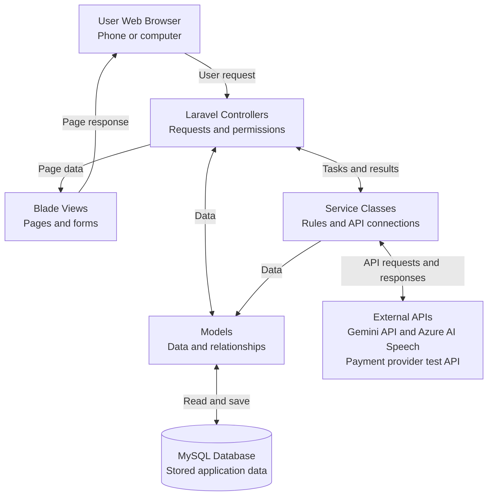

# Krishi Bondhu: Agricultural Management and Marketplace Platform for Bangladesh

**CSE470: Software Engineering: Software Requirements Specification (SRS)**
*End-of-Semester Submission Template*

> **Living document.** This Markdown file is the team's working copy of the SRS and is updated as development
> progresses. Transcribed from `CSE470_SRS_Template_Group-8.pdf` on 2026-11-12. Change it through normal PRs and
> record meaningful scope changes in the revision log at the bottom.

## Prepared by

| Name | GitHub |
| --- | --- |
| Md. Abdullah Al Jarif | jarifff |
| Md. Mahfuz Ahmed Emon | imoooooooon |
| Mehrab Hossain Nizami | mugdhoo44 |
| Mir Mohammad Sajedul Islam | sajedulislam5840 |

Student IDs are kept in the original PDF (local `course-docs/`), not in this public repository.

## Project information

| Item | Value |
| --- | --- |
| Section | Group 8 (Faculty: NZU) |
| Section faculty | Nazmul Islam |
| GitHub repository | <https://github.com/imoooooooon/KrishiBondhu> |
| Tech stack used | PHP 8.4 + Laravel 13 (MVC), Blade, JavaScript, MySQL 8.4 LTS. See [README](../README.md) |

---

## 1. Introduction

### 1.1 Purpose

This document describes the software requirements for Krishi Bondhu. Krishi Bondhu aims to help farmers in
Bangladesh sell crops at fair prices and manage their farming needs. It connects farmers with buyers, workers, and
veterinary doctors. It also provides market prices, cattle records, and farming guidance. Bangla text and voice
support help farmers use the platform.

### 1.2 Scope

Krishi Bondhu is a web-based platform for farmers and other agricultural users in Bangladesh. It helps farmers sell
crops directly to buyers, negotiate prices, and receive payments through the platform.

The platform covers five main service areas:

- **Crop marketplace:** Farmers can list crops for sale. Buyers can search for crops, negotiate prices, and place orders.
- **Cattle breeding records:** Farmers and insemination agents can keep cattle profiles, breeding records, and family history.
- **Market prices:** Users can view local market prices, compare prices, and find nearby markets.
- **Crop and animal health guidance:** Farmers can get basic guidance about crop diseases, animal health, and
  fertilizers. They can also find veterinary doctors.
- **Worker booking and Bangla support:** Farmers can find and book agricultural workers. Bangla text and voice
  features help users access the platform.

The platform serves farmers, buyers, agricultural workers, insemination agents, market price contributors,
veterinary doctors, agricultural product sellers, and administrators.

Krishi Bondhu will not run its own delivery service or perform physical soil tests. It can help users arrange
delivery and use existing soil-test results for fertilizer guidance.

## 2. Overall Description

### 2.1 Product Perspective

Krishi Bondhu is an independent web-based platform for agricultural users in Bangladesh. Its intended users
currently rely on phone calls, middlemen, paper records, and separate services for many farming tasks. Krishi Bondhu
brings crop trading, cattle records, market prices, health guidance, and worker booking into one place. It supports
these activities by helping users share information, keep digital records, and connect with each other.

### 2.2 Product High-Level Summary

Krishi Bondhu will provide the following main functions:

- **Accounts and roles:** Users can access multiple roles through one account. For example, a farmer can also buy
  crops or work on another farm.
- **Crop marketplace and payments:** Farmers can manage crop listings. Buyers can search for crops, negotiate
  prices, place orders, and pay through the platform.
- **Cattle breeding records:** Farmers and insemination agents can maintain cattle profiles and breeding records.
  The system can track family history and warn about possible inbreeding.
- **Market information:** Users can view crop prices, compare local markets, and find market locations. They can
  also view past prices to help plan crop sales.
- **AI-based farming guidance:** The system can suggest possible crop and animal diseases using photos or symptoms.
  It can also suggest fertilizers using available soil information.
- **Veterinary services:** Farmers can find nearby veterinary doctors and contact them for animal healthcare.
- **Agricultural worker booking:** Farmers can post jobs and book workers. Workers can find jobs, apply, and
  negotiate wages.
- **Bangla support:** Bangla text, voice commands, spoken responses, and simple visual controls help users access
  the platform.
- **Administration:** Administrators can manage users and listings. They can also review complaints and monitor
  platform activities.

### 2.3 Users and Characteristics

Krishi Bondhu has eight user roles. One person can use more than one role through the same account.

| User Role | Role and Characteristics |
| --- | --- |
| Farmer | Sells crops, manages cattle records, checks market prices, uses farming guidance, buys agricultural products, and books workers. |
| Buyer | Searches for crops, negotiates prices, places orders, and pays through the platform. Buyers include individual customers, retailers, restaurants, and wholesalers. |
| Agricultural Worker | Searches for farm jobs, applies for work, negotiates wages, and checks bookings. Some workers may have limited experience with websites and prefer Bangla text and voice support. |
| Insemination Agent | Records cattle insemination details, including dates, bull or semen IDs, service costs, and agent information. |
| Market Price Data Contributor | Enters and updates crop prices from local markets. Helps users access accurate market information. |
| Veterinarian | Provides animal health consultations and receives requests for farm visits. Helps farmers with serious animal health problems. |
| Agricultural Product Seller | Lists and sells fertilizers, pesticides, and other farming products through the platform. Provides product details and prices. |
| Administrator | Manages users and listings, reviews complaints, and monitors platform activities. |

### 2.4 Operating Environment

Krishi Bondhu will initially run as a web application. Users can access it through a modern web browser on a
smartphone or computer.

An internet connection is required for all main tasks. Low-data mode will help users access the platform on slow
connections.

Users must allow microphone access to use voice features. For location-based features, users can allow location
access or enter their location manually. Devices must support Bangla text display and audio playback for Bangla
text and spoken responses.

### 2.5 Design and Implementation Constraints

This project will follow the CSE470 rules, including the required MVC architecture.

**(a) Primary Technology Stack**

The application will use PHP with Laravel for the backend. The frontend will use Blade templates, HTML, CSS,
and JavaScript, styled by the Krishi Bondhu design system (custom CSS tokens and Blade components, no CSS framework; see [design-system.md](design-system.md)). MySQL will store the application data.

**(b) MVC Framework and Structure**

Laravel will organize the application into three parts:

- **Model (`app/Models`):** Manages application data and relationships.
- **View (`resources/views`):** Displays pages and forms using Blade templates.
- **Controller (`app/Http/Controllers`):** Handles user requests and connects models with views.

Separate service classes will handle complex tasks, such as price calculations and AI requests.

**(c) AI Features and Service**

The proposed AI service is Gemini API. It will support suggestions about possible crop and animal diseases and
suitable fertilizers. Laravel will call Gemini directly from the server. FastAPI will not be used.

The team plans to use a model with a free tier for initial development and testing. AI features will depend on API
availability and usage limits. The API key will remain on the server. The team will confirm the proposed AI approach
with the faculty.

**(d) Faculty-Approved Exceptions**

No faculty-approved exceptions to the course's technology rules have been granted.

### 2.6 Assumptions and Dependencies (Optional)

**(a) Assumptions**

- Users will have an internet connection and a compatible web browser.
- Users will provide correct information about crops, cattle, products, and jobs.
- Market price contributors will enter and update prices manually. Prices will depend on their updates.
- Users will allow microphone access for voice features. They can allow location access or enter a location manually.

**(b) External Dependencies**

- AI guidance will depend on Gemini API availability and usage limits.
- Maps are planned to use Leaflet with OpenStreetMap. The application will follow the map provider's usage rules.
- Bangla voice features are planned to use Azure AI Speech. This choice will be confirmed after testing speech
  recognition with Bangladeshi speakers.
- Online payments will initially use a payment provider's test environment. No real money will be transferred
  during these tests. The payment provider has not yet been selected.
- External services may have free usage limits. Features that use these services may be temporarily unavailable
  when a limit is reached.

## 3. System Architecture

### 3.1 Architectural Overview

Krishi Bondhu will use Laravel and follow the MVC architecture. It will run as one web application connected to a
MySQL database.

The application will have six main areas: accounts, marketplace and payments, cattle records, market information,
health guidance, and worker booking. Bangla text and voice support will work across supported tasks.

**Model:** Models will manage data and relationships. Examples include User, CropListing, Order, Cattle, and Booking.

**View:** Blade templates will display pages and forms. Shared Blade components from the design system make pages fit phone and computer screens.

**Controller:** Controllers will receive user requests, check permissions, and coordinate actions between models
and views.

Separate service classes will handle complex tasks, such as price calculations, breeding checks, and external API
requests.

*Figure 3.1: MVC Architecture of Krishi Bondhu*

For example, when a farmer submits a crop listing, the controller checks the request and the farmer's permission.
The model saves the listing in the database. The controller then returns a view showing the result.

Each user will have one account and may hold several roles. The backend will check the user's permissions before
allowing access to protected actions.

### 3.2 Technology Stack

| Layer or Purpose | Technology | Use |
| --- | --- | --- |
| Frontend | Blade, HTML, CSS (Krishi Bondhu design system), and JavaScript | Displays pages, forms, and interactive controls on phones and computers. |
| Backend | PHP with Laravel | Handles user requests, permissions, and application logic using MVC. |
| Database | MySQL 8.4 LTS | Stores users, listings, orders, cattle records, bookings, and other application data. |
| Hosting | alwaysdata free plan | Hosts the application and database for the university demonstration. |
| AI Guidance | Gemini API | Provides general farming guidance and suggestions about possible crop and animal diseases. |
| Maps | Leaflet with OpenStreetMap | Displays market and veterinary locations on maps. |
| Bangla Speech | Azure AI Speech | Supports Bangla voice input and spoken responses. This choice will be confirmed after testing with Bangladeshi speakers. |
| Test Payments | SSLCommerz sandbox | Tests payment success, failure, and cancellation without transferring real money. |
| Version Control | Git and GitHub | Tracks code changes and supports collaboration among team members. |

### 3.3 Class Diagram

[Drawio link](https://drive.google.com/file/d/1WFHc6mUnJ_ki_QvPIDDJLbwWoMEMqU7g/view?usp=sharing)

## 4. Requirements and Features

The following requirements describe 26 planned features. Related actions are grouped into one feature. Login,
registration, and password reset support the application but are not counted as separate features.

Small orders use fixed prices. Buyers can add items to a cart and place orders. Bulk orders allow price negotiation
within the seller's limits.

### Crop Marketplace and Price Negotiation

| Req. ID | Requirement | Feature ID and Description | Actor | MVC Components Touched | Sprint Completed | Status |
| --- | --- | --- | --- | --- | --- | --- |
| R1 | Farmers can offer crops for sale. | **F1: Crop Listing Management.** Farmers can create, view, edit, and remove crop listings. Listings include photos, quantity, price, quality, harvest date, and delivery options. Required details are checked before publication. | Farmer | Model: CropListing View: CropListingPages Controller: CropListingController | Not assigned | Planned |
| R2 | Buyers can find crops and request bulk supplies. | **F2: Crop Search and Bulk Requests.** Buyers can filter crops by price, location, and quality. They can post bulk requests, receive offers from farmers, and select an offer. | Buyer, Farmer | Model: CropListing, BulkRequest, Bid View: CropSearchAndRequestPages Controller: BulkRequestController | Not assigned | Planned |
| R3 | Buyers and farmers can negotiate bulk crop prices. | **F3: Limited Bulk Price Negotiation.** Farmers set a private minimum price. Buyers can offer prices between that minimum and the listed price. Farmers can accept, reject, or make a counteroffer. The system saves the agreed price. | Buyer, Farmer | Model: CropListing, PriceOffer View: NegotiationPage Controller: NegotiationController | Not assigned | Planned |
| R4 | Users can review delivery choices and the full order cost. | **F4: Delivery and Cost Calculation.** Users can choose pickup or delivery arranged by the buyer, farmer, or a third party. The system calculates the crop cost and applicable delivery, packaging, and platform charges before confirmation. | Buyer, Farmer | Model: Order, DeliveryArrangement View: OrderReviewPage Controller: CheckoutController | Not assigned | Planned |
| R5 | Users can place orders and track stock and order progress. | **F5: Cart, Order, and Stock Management.** Buyers can add fixed-price crops to a cart and confirm orders. Accepted bulk offers can also become orders. The system updates stock, prevents excess orders, and shows order status. Buyers can cancel before processing begins. Cancelled orders release reserved stock. Status updates appear inside the website. | Buyer, Farmer | Model: Cart, Order, OrderItem, CropListing View: CartAndOrderPages Controller: OrderController | Not assigned | Planned |

### Cattle Breeding and Lineage Management

| Req. ID | Requirement | Feature ID and Description | Actor | MVC Components Touched | Sprint Completed | Status |
| --- | --- | --- | --- | --- | --- | --- |
| R6 | Farmers can maintain records of their cattle. | **F6: Digital Cattle Profiles.** Farmers can register cattle with a unique ID, photo, breed, age, parent details, and health history. They can view and update their own cattle records. | Farmer | Model: Cattle View: CattleProfilePages Controller: CattleController | Not assigned | Planned |
| R7 | Breeding services can be recorded against cattle profiles. | **F7: Insemination Service Records.** Agents can record service dates, bull or semen IDs, costs, and agent details for a farmer's cattle with the farmer's permission. Farmers can view the records. The system keeps a history of changes. | Insemination Agent, Farmer | Model: Cattle, InseminationRecord View: InseminationRecordPages Controller: InseminationController | Not assigned | Planned |
| R8 | Farmers can track cattle family history. | **F8: Parentage and Family Tree Tracking.** Farmers can link calves to their recorded mother and father. The system uses these links to display a family tree across generations. | Farmer | Model: Cattle View: CattleFamilyTreePage Controller: LineageController | Not assigned | Planned |
| R9 | Users can check breeding pairs for possible close relationships. | **F9: Inbreeding Warnings.** Before a breeding service is recorded, the system checks available family records through three generations. It warns about shared ancestors and missing records. | Farmer, Insemination Agent | Model: Cattle, InseminationRecord View: BreedingCheckPage Controller: BreedingCheckController | Not assigned | Planned |
| R10 | Farmers can track pregnancy and calving dates. | **F10: Pregnancy and Calving Tracking.** Farmers can record pregnancy checks, expected calving dates, and actual calving dates. Checkup and calving reminders appear inside the website. | Farmer | Model: PregnancyRecord, Reminder View: PregnancyTrackingPage Controller: PregnancyController | Not assigned | Planned |

### Crop Prices and Market Locations

| Req. ID | Requirement | Feature ID and Description | Actor | MVC Components Touched | Sprint Completed | Status |
| --- | --- | --- | --- | --- | --- | --- |
| R11 | Users can access manually updated local crop prices. | **F11: Market Price Tracking.** Contributors enter and update crop prices for local markets. Users can view the price per kilogram and the date last updated. Previous price entries are kept for history. | Market Price Data Contributor, Farmer, Buyer | Model: Market, MarketPrice View: MarketPricePages Controller: MarketPriceController | Not assigned | Planned |
| R12 | Farmers can find nearby markets. | **F12: Market Location and Distance.** The system displays recorded markets on a map. Farmers can use their current location or enter a location to view nearby markets and approximate distances. | Farmer, Buyer | Model: Market View: MarketMapPage Controller: MarketLocationController | Not assigned | Planned |
| R13 | Farmers can compare selling prices between markets. | **F13: Market Price Comparison.** Users can select a crop and compare its price per kilogram across markets. Each result shows the market and update date. | Farmer, Buyer | Model: Market, MarketPrice View: PriceComparisonPage Controller: PriceComparisonController | Not assigned | Planned |
| R14 | Farmers can review past crop prices. | **F14: Market Price Trends.** Users can select a crop, market, and time period. The system displays saved prices in a simple chart or table to help users understand price changes. | Farmer, Buyer | Model: MarketPrice View: PriceTrendPage Controller: PriceTrendController | Not assigned | Planned |

### Crop and Animal Health Guidance

| Req. ID | Requirement | Feature ID and Description | Actor | MVC Components Touched | Sprint Completed | Status |
| --- | --- | --- | --- | --- | --- | --- |
| R15 | Farmers can receive general guidance from basic soil observations. | **F15: Soil-Based Fertilizer Guidance.** Farmers describe soil color, moisture, texture, and the crop they grow. They may add a photo. AI provides general soil-care and fertilizer suggestions. These observations do not provide exact nutrient measurements. | Farmer | Model: SoilGuidanceRecord View: SoilGuidancePage Controller: SoilGuidanceController | Not assigned | Planned |
| R16 | Farmers can get guidance about possible crop diseases and pests. | **F16: Crop Disease Identification.** Farmers upload crop photos and describe the problem. AI suggests possible diseases or pests and basic care options. Results are presented as guidance rather than a confirmed diagnosis. | Farmer | Model: CropHealthRecord View: CropHealthPage Controller: CropHealthController | Not assigned | Planned |
| R17 | Farmers can get basic guidance about animal health problems. | **F17: Animal Health Guidance.** Farmers enter symptoms and may upload photos of cows or goats. AI suggests possible causes and basic care guidance. Farmers can use the veterinary service feature to seek professional help. | Farmer | Model: AnimalHealthRecord View: AnimalHealthPage Controller: AnimalHealthController | Not assigned | Planned |
| R18 | Farmers can find veterinary doctors and request farm visits. | **F18: Veterinary Search and Visit Requests.** Farmers can view veterinary doctors' locations and contact details. They can send a simple farm-visit request. Doctors can view and respond to requests. | Farmer, Veterinarian | Model: VeterinarianProfile, VisitRequest View: VeterinaryServicePages Controller: VeterinaryServiceController | Not assigned | Planned |
| R19 | Farmers can keep treatment notes and follow-up dates. | **F19: Treatment History and Reminders.** Farmers can save crop and animal health problems, treatment notes, and follow-up dates. They can review past records and receive reminders inside the website. | Farmer | Model: TreatmentRecord, Reminder View: TreatmentHistoryPages Controller: TreatmentController | Not assigned | Planned |

### Agricultural Worker Booking and Bangla Support

| Req. ID | Requirement | Feature ID and Description | Actor | MVC Components Touched | Sprint Completed | Status |
| --- | --- | --- | --- | --- | --- | --- |
| R20 | Farmers can advertise jobs, and workers can find suitable work. | **F20: Farm Job Posting and Search.** Farmers can post jobs with the work type, location, date, required workers, wages, and meal or transport details. Workers can search and filter available jobs. | Farmer, Agricultural Worker | Model: FarmJob View: FarmJobPages Controller: FarmJobController | Not assigned | Planned |
| R21 | Farmers can book individual workers or groups. | **F21: Worker Booking and Wage Negotiation.** Workers can apply individually or through a group leader. Farmers and workers can agree on daily, task-based, or unit-based wages. Farmers confirm bookings, and the system prevents bookings beyond the required worker count. | Farmer, Agricultural Worker | Model: JobApplication, WorkerGroup, Booking View: WorkerBookingPages Controller: WorkerBookingController | Not assigned | Planned |
| R22 | Farmers and workers can report job-related complaints. | **F22: Job Complaint Handling.** Farmers and workers can submit complaints linked to a job or booking. Administrators can review complaints, record their response, and update the complaint status. Users can view the response. | Farmer, Agricultural Worker, Administrator | Model: Complaint, Booking View: ComplaintPages Controller: ComplaintController | Not assigned | Planned |
| R23 | Users can perform main tasks and searches through Bangla speech. | **F23: Bangla Voice Commands and Spoken Forms.** Users can search and complete supported main tasks through Bangla voice input. The system can read prompts and results aloud. Users confirm spoken form details before submission. | Users of supported voice features | Model: Data model for the selected task View: BanglaVoiceControls Controller: VoiceController | Not assigned | Planned |
| R24 | Users can access a simple Bangla interface on slow connections. | **F24: Picture-Based Bangla Interface and Low-Data Mode.** The website uses Bangla text, large buttons, and clear icons. Low-data mode reduces image sizes. Saved form progress helps users continue unfinished forms after a connection problem. | All Users | Model: UserPreference View: SharedBanglaLayouts Controller: UserPreferenceController | Not assigned | Planned |

### Agricultural Product Sales and Online Payments

| Req. ID | Requirement | Feature ID and Description | Actor | MVC Components Touched | Sprint Completed | Status |
| --- | --- | --- | --- | --- | --- | --- |
| R25 | Agricultural product sellers can sell farming supplies through the platform. | **F25: Agricultural Product Sales.** Sellers can manage products, prices, stock, and received orders. Buyers can search products and use a cart for small orders at fixed prices. Bulk orders allow offers and counteroffers within the seller's minimum price limit. Order cancellation follows the rule in F5. | Agricultural Product Seller, Buyer, Farmer | Model: AgriculturalProduct, Cart, Order, PriceOffer View: AgriculturalProductPages Controller: AgriculturalProductController | Not assigned | Planned |
| R26 | Users can test online payments for crop and product orders. | **F26: Online Payment Processing.** Users can pay through the selected provider's test environment. The system records payment attempts and checks the provider's response before marking an order as paid. It shows success, failure, or cancellation. No real money is transferred during testing. | Buyer, Farmer | Model: Payment, Order View: PaymentPages Controller: PaymentController | Not assigned | Planned |

### 4.1 Feature Count Summary

| Item | Value |
| --- | --- |
| Minimum features required (per Project Outline) | 20 |
| Total features listed in Section 4 above | 26 |
| Total features fully completed ("Done") | none |

## 5. External Interface Requirements (Optional)

| Interface Type | Description |
| --- | --- |
| User Interface | |
| Hardware Interface | |
| Software Interface (APIs, third-party services) | |
| Communication Interface | |

## 6. Non-Functional Requirements (Optional)

| Category | Requirement |
| --- | --- |
| Performance | |
| Security | |
| Usability | |
| Reliability / Availability | |
| Scalability | |

## 7. Sprint History and Review Ceremony Log

Record the goals and attainment shared during each weekly sprint review ceremony, per the Project Outline.

| Sprint | Goals Set (Start of Week) | Attainment Reported (End of Week) | Features Completed This Sprint |
| --- | --- | --- | --- |
| Sprint 1 (deadline 14 Nov 2026) | | | |
| Sprint 2 (deadline 5 Dec 2026) | | | |
| Sprint 3 (deadline 13 Dec 2026) | | | |
| Sprint 4 (deadline 20 Dec 2026) | | | |

### 7.1 Deviations and Lessons Learned

*[Briefly explain any sprint where attainment did not match the planned goals, why it happened, and what was
adjusted for the following sprint.]*

## 8. Testing Summary

*[Briefly describe how each major feature was tested (manual testing steps, sample test cases, or automated tests).
A short table or list is acceptable.]*

## 9. AI Tool Usage Disclosure

Per the Project Outline's AI-Assisted Development Policy, disclose every instance where a generative AI tool was
used during development. Leave the table empty (do not delete it) if no AI tool was used. Day-to-day entries are
kept in [ai-usage.md](ai-usage.md) and summarised here for submission.

| Feature / Task | AI Tool Used | How It Was Used (be specific) | I Can Fully Explain This Code (Yes/No) |
| --- | --- | --- | --- |
| | | | |

*[By submitting this document, you confirm that you are able to personally explain, modify, and debug every piece
of code listed above during your viva.]*

## 10. Individual Contribution Summary

*[Summarize your own work: which features you implemented, approximate time spent per sprint, and any challenges
you solved independently. If you collaborated with your group on non-code matters (e.g. idea discussion), state
that clearly and distinguish it from your individual implementation work.]*

## 11. Pre-Submission Checklist

| Checklist Item | Confirmed (Yes/No) |
| --- | --- |
| The application implements the MVC architecture | |
| At least 20 features are listed and each is correctly counted per the granularity rule | |
| No forbidden framework (e.g. Django, Flask as primary backend) was used | |
| All four sprints' goals and attainment are recorded in Section 7 | |
| The GitHub repository is up to date and the section faculty is added as a collaborator | |
| The AI Usage Disclosure table (Section 9) is complete and honest | |
| I can personally explain and defend every feature listed in this document during the viva | |

---

## Revision log

| Date | Change | By |
| --- | --- | --- |
| 2026-11-12 | Frontend stack: Bootstrap replaced by the Krishi Bondhu design system (custom CSS + Blade components, no framework, no build step) in §2.5, §3.1, §3.2. Route map in [IA.md](IA.md). | Emon (with Claude Code) |
| 2026-11-12 | Transcribed from the PDF to Markdown. Repository link updated from `Project470` to `KrishiBondhu`; database in §3.2 changed from MariaDB to MySQL 8.4 LTS (matching §2.5 and the confirmed setup); tech stack row filled in; architecture figure redrawn as a Mermaid diagram; sprint deadlines added to §7; checklist cross-reference to the AI disclosure corrected to §9. Student IDs and faculty email kept out of the public copy. | Emon (with Claude Code) |
